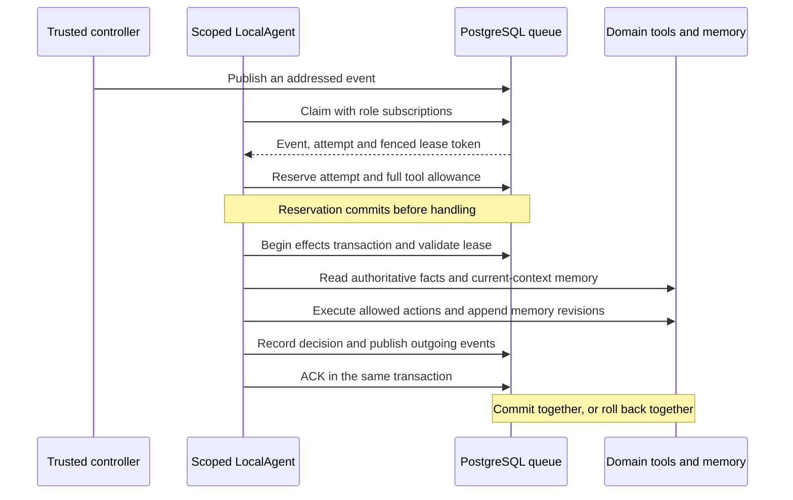

# How this project's agents are built

Source review: 2026-10-28. This describes the executable implementation, not an
illustrative ADK design. Start with this document, then read the
[GCP component inventory](GCP-COMPONENTS.md) and
[enterprise architecture decisions](ENTERPRISE-GCP.md).

## The agent object

An agent is a frozen `LocalAgent` containing an authenticated `AgentScope`, a
validated `RoleSpec`, its scoped database identity and, for an explicitly enabled
GCP judge, a gateway origin. Its public work loop is `claim()` → `process(event)`.
The shared class is in [agent_runtime.py](../src/delivery/agent_runtime.py).
`create_inventory_agent` is an alias of `create_agent`, not a separate framework.

Most agents use fixed Python decision policies. Restaurants can instead select
the [Google ADK adapter](ADK-RESTAURANT.md), with editable prompts/SOUL and granular
tools. Its current model is a scripted offline fixture; Gemini is not enabled.
Inventory arithmetic, sourcing,
consent, route selection and custody are enforced by domain code and SQL. The
recovery judge is the previously live-verified Google model path; restaurants now
also have a disabled-by-default, budgeted native Vertex adapter. The city is a realistic test
environment for those boundaries; running a city is not itself an LLM workload.

| Building block | Actual implementation | What it guarantees |
| --- | --- | --- |
| Definition | `RoleSpec`, `RoleLimits`, server-owned `AUTHORITY` in [agent_specs.py](../src/delivery/agent_specs.py) | Strict fields, frozen objects, bounded limits and supported tool/topic subsets |
| Provisioning | `inventory_access`, `role_access`, `supply_access` in [agent_access.py](../src/delivery/agent_access.py) | Trusted controller creates a login, binds its scope and snapshots definition/hash |
| Factory | `create_agent` in [agent_runtime.py](../src/delivery/agent_runtime.py) | Reads scope from authenticated SQL functions and checks the saved definition hash |
| Work delivery | `Queue` and [queue capability migration](../sql/migrations/014_queue_capability.sql) | Addressed claims, lease fencing, priorities, due time, retry/backoff and dead letters |
| Action boundary | `ScopedTools.invoke` and role-specific SQL functions | Fixed callable registry; authenticated scope and live budget/lease checks |
| Memory | [typed_memory.py](../src/delivery/typed_memory.py), [typed-memory migration](../sql/migrations/015_typed_memory.sql) | Typed observations, current-context recall, source events, expiry and revision history |
| Accountability | Decisions, tool receipts, memory read/write receipts and queued lineage | Inspect what the worker observed and changed, with business replay where implemented |

## From editable definition to an authenticated worker

1. The operator edits a supported role's `role.json` and `SOUL.md`, or a supply
   blueprint's agent/entity definitions. `AUTHORITY` is application code; an edit
   cannot add a role kind, new tool implementation or new allowed topic.
2. The loader validates the definition and resolves SOUL text. `RoleSpec.digest`
   hashes its canonical resolved JSON, including that text. Role-file SOUL paths
   are constrained to the supported definition directory.
3. The trusted controller creates a restricted PostgreSQL login per run/namespace.
   `agent_bindings` stores the login, run, namespace, agent ID, definition and hash;
   budget tables store the corresponding limits. Passwords stay in the controller's
   process and scoped connection objects, not in prompts or exported evidence.
4. `create_agent(dsn, agent_mode=..., cloud_endpoint=...)` calls `agent_scope()` and
   `agent_definition()` as that login. It rejects missing bindings, invalid hashes,
   incompatible judge modes and a cloud judge without an endpoint.
5. Later blueprint/role-file edits affect new runs. The running agent reads its
   frozen database definition. New supply runs additionally snapshot recipes,
   demand schedules and entity settings; blueprint updates use revision checking.
6. Normal run completion/failure retires the temporary logins through
   `retire_inventory_access`. Definitions and evidence can remain for inspection.
   Abrupt controller death still needs a durable supervisor/reaper.

For supply agents, [supply_models.py](../src/delivery/supply_models.py) defines
`AgentDefinition` and `EntityDefinition`; `supply_access` converts the frozen
run/entity settings into `RoleSpec`. They do not load restaurant/market role files
from `config/agents`. Display name, SOUL, simulated latency, search options and
bounded limits are editable. A fictional display name does not change a principal.

## What SOUL means today

SOUL is versioned and inspectable guidance. **The deterministic policies do not
interpret it.** Editing it does not teach a courier a new strategy or change stock
arithmetic. Business settings such as stock, hours, consent and latency have
explicit implemented effects.

The GCP judge does not receive its local role SOUL either. Its cloud container
has a separate fixed `systemInstruction` and `PROMPT_VERSION` in
[gateway.py](../infra/gcp-ai/gateway.py). Consequently, a local SOUL hash is not
proof of the exact model prompt. Cloud experiments must retain the gateway prompt
version/image digest as well as the local role definition hash.

The restaurant ADK adapter assembles platform instructions, the frozen role prompt
and SOUL, then supplies scoped tools and current-order recall. Its two offline
profiles demonstrate that instructions reach the actual ADK function-calling loop.
The scripted model implements those fixture strategies; this is not evidence of
generative-model quality. Permissions and budgets remain enforced independently.
Other roles and the cloud judge keep the behavior described above.

## Roles, namespaces and tools

`store` in internal binding tables is a namespace field; it is not always a shop.
Every role has typed `memory.read` and `memory.write`. The domain tools below are
prefixed exactly as their runtime registry names indicate.

| Role | Binding namespace | Domain tools | Typed fact kind |
| --- | --- | --- | --- |
| Inventory | `store-N` | `inventory.read/reserve/release/delay/receive` | `inventory.reservation`, `inventory.shipment` |
| Fulfillment | `fulfillment:store-N` | `fulfillment.read/pick` | `fulfillment.progress` |
| Dispatcher | `dispatcher:fleet` | `dispatch.read/assign/complete/recover/defer` | `delivery.progress` |
| Courier | `courier:<fleet-id>` | `courier.read/accept` | `courier.commitment` |
| Judge | `judge:fleet` | `judge.read/review` | `recovery.verdict` |
| Household | Entity ID | `supply.read/command` | `household.order` |
| Restaurant | Entity ID | `supply.read/command` | `restaurant.order` |
| Market | Entity ID | `supply.read/command` | `market.request` |

That table describes the default deterministic supply workers. An ADK restaurant
uses `restaurant.*` capabilities listed in the [ADK chapter](ADK-RESTAURANT.md)
and a separate restricted PostgreSQL group. It cannot call `supply.command` or
read the legacy broad supply context. Its typed memory contract remains unchanged.

Workflow roles use `queue.publish` within their topic/recipient policy. Supply
commands produce a fixed SQL outbox; the agent cannot choose arbitrary recipients.
Although `supply.search` is declared in the supply authority contract, it is not a
`ScopedTools.invoke` implementation. Restaurant/market search is the separate
authenticated `search_for_agent` path in
[supply_search_service.py](../src/delivery/supply_search_service.py); the fixed
`SupplyPolicy` does not automatically call it. Optional Jev search and its budgets
are separate from the GCP judge.

Examples of the actual queue contracts are inventory `basket.requested` →
`basket.reserved`, fulfillment → `basket.ready`, dispatcher → `courier.briefed`,
courier → `courier.accepted`, and failed delivery → judge `recovery.reviewed`.
Complete accepted/emitted sets live in `AUTHORITY`, not in this abbreviated list.
No role exposes a direct agent-call tool. Simulated phone calls are typed queued
messages, not telephony sessions or free-form LLM conversations.

## The existing HTTP communication endpoints

These local supply routes are implemented in
[supply_api.py](../src/delivery/supply_api.py). Their common prefix is
`/api/supply/runs/{run}/agents/{agent_id}`:

| Method / suffix | Authentication and behavior |
| --- | --- |
| `POST /channel` | Operator `X-Operator-Key`, matching configured `DELIVERY_OPERATOR_KEY`; issues a one-hour bearer channel for an active agent |
| `POST /claim` | Scoped bearer channel; claims an addressed queued event and returns its event/lease/attempt envelope |
| `POST /messages` | Scoped bearer plus matching envelope; processes the existing leased event, never arbitrary caller-supplied message content |
| `POST /calls` | Same mechanism, restricted to an owned household-intent lease |
| `POST /search` | Scoped bearer/envelope plus bounded query and frozen provider choice; restaurant/market search path |
| `POST /memory/recall` | Scoped bearer/envelope; consumes a tool allowance; only supported type/limit filters |
| `GET /memory` | Authenticated legacy route returns 410; broad memory retrieval is unavailable |

Envelope fields are `event_id`, `lease_token` and `attempt`. Database checks still
fence stale leases even after HTTP authentication. Blueprint, run/order history,
agent inspection and replay endpoints are separate **trusted operator views**;
they are not tools available to an agent.

Channel-token hashes, active agents and claimed HTTP lease references are currently
process-local dictionaries. They do not survive a restart or provide a shared
identity layer for several API replicas. Base Compose binds the app to loopback;
the Host/origin checks are local-demo safeguards, not enterprise authentication.
A cloud deployment needs workload OIDC/IAM and durable lease/controller handling;
publishing the existing operator API unchanged would expose broader inspection.

## One event, including the transaction boundaries



`LocalAgent.process` first commits the attempt/tool reservation. Optional GCP mode
then prepares a durable scoped request, commits its single-dispatch admission,
closes the worker's database connection, invokes the provider and saves its result
in a separate short transaction. Then `Queue.process` obtains the run
advisory lock and event row lock, checks the fence, reloads the authoritative
payload and invokes `handle`. The handler selects `InventoryPolicy`, `SupplyPolicy`
or `WorkflowPolicy`/`FleetPolicy` and records the decision before ACK commits.

Handler failure or lease expiry rolls back domain changes, memory, decision,
outgoing events and transactional tool charges. Failure scheduling happens
separately. Durable attempt/model reservations are not refunded. Deduplication
and domain invariants provide idempotent business effects; they do not establish
exactly-once external inference or billing. See [queue.py](../src/delivery/queue.py).

**Durable cloud path:** `FleetPolicy.cloud_judgement` only consumes a saved result;
it cannot invoke the provider. The effects transaction compares the saved context,
proposal, memory and simulated time with current authoritative observations before
SQL independently checks feasibility. A retry of the same source event reuses a
saved result without another model charge. An abandoned in-flight invocation has
an unknown outcome and fails closed rather than automatically resending. The
request snapshot and its preparatory read/tool receipts commit independently of
the final effects transaction. See [durable inference](DURABLE-INFERENCE.md),
[orchestration](../src/delivery/durable_inference.py) and the
[request state machine](../sql/migrations/016_durable_inference.sql).

## Permissions and memory are enforced outside the prompt

Logins are non-superuser, cannot create databases/roles, replicate or bypass RLS.
Scope derives from PostgreSQL `session_user`, not a model-supplied store ID or
mutable connection setting. Inventory can inspect its own run/store stock through
RLS. Other domain roles receive narrow functions/projections rather than raw stock
tables. Tools require a live lease, supported event and durable budget ticket.

Typed memory writes derive owner, order/shipment, subject, source event, revision
and observation time on the server. Bodies are limited to 2 KiB; TTL is 1–86,400
simulated seconds, additionally constrained by the role's live entry/byte caps.
Recall defaults to eight facts, permits at most sixteen and bounds complete result
envelopes to 8 KiB. Market recall is ingredient-request-specific; courier recall
also matches the assignment attempt. A newer expired revision suppresses older
values. Raw current/history/legacy memory tables are denied to agents.

Expiry controls recall eligibility; it does **not** erase audit history. Revisions
and decision inspection remain until trusted cleanup. There is no pgvector search,
cross-order learning, automatic summary consolidation or managed Memory Bank.
[Memory contracts and retention](AGENT-MEMORY.md) contain the detailed semantics.

The controller, operator UI/API, host and fixed Python policies are trusted. One
Python process can hold several scoped connections; this is not a container/OS
sandbox for hostile Python. M1 also retains its older shared-account runtime.
Enterprise workload identities and process boundaries must complement these
database controls; adding an ADK subagent object alone provides neither.

## Budgets and reproducible evidence

The original inventory profile has 100 attempt reservations, eight tool slots per
attempt, 400 per run, 32 live facts and 16,384 live body bytes. These are not global
defaults for every business role. Supply sessions set aggregate allowances of
12,000 attempts/48,000 tool slots and resolve larger dispatcher/courier profiles
before freezing them. Inspect the saved definition and budget for a particular run.

The optional [judge-gcp definition](../config/agents/judge-gcp/role.json) permits six
model calls and 50,688 reserved tokens. Each request reserves 8,448 tokens
(8,192 input + 256 output). `model_usd: 0` is a schema literal, **not a working
dollar ceiling** for paid GCP mode. Gateway-wide monetary admission remains a gap.

```bash
make health
make eval-agents
```

The [role battery](AGENT-EVALS.md) runs actual scoped agents on twelve fixed
scenarios and scores 49 declared criteria. The 2026-10-28 receipt records 392
passing tests and matching repeated seed-731 outcomes. This is development
regression/isolation evidence, not proof of LLM quality, scalability or production
readiness. [GCP live verification](GCP-VERIFICATION.md) is a separate dated record.
