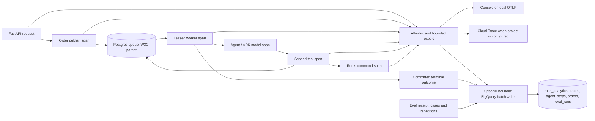

# Observability architecture

Tracing and BigQuery analytics are independent opt-ins. Both are disabled by
default. Setting a project ID alone does not discover credentials or send data.
Model inference has its existing, separate admission and cost controls.

## Trace flow

This diagram follows an order through the API, durable queue, agents and tools:



An order's trace
ID is derived from its run ID and canonical queue trace key. Reusing an order key
in another run creates a different trace. Migration 027 extends the original
telemetry migration and supports both previously shipped branch schemas. It
persists W3C parents, copies them to SQL-produced descendants and fences worker
updates with the existing lease. Trace context confers no queue authority.

FastAPI and Redis use OpenTelemetry instrumentors. Queue processing, scoped
agent/tool execution and ADK model calls add explicit spans. Agent/tool names,
run/order IDs, attempts, model usage and estimated USD cost are structured
attributes. Model spans carry cost once; outer agent/tool spans do not duplicate
it. Missing usage remains unknown. Costs are estimates, not a billing statement.

The exporter strips request bodies, tool arguments, Redis command arguments,
exception messages and stack traces. The application's private provider does not
enable ADK's raw prompt/response tracing. Existing private Postgres evidence is
unchanged. Span names and the documented operational attributes are exported;
use synthetic, non-sensitive order IDs.

## Local tracing

With dependencies installed, enable console export in the process you want to
inspect:

```bash
MDS_TELEMETRY_ENABLED=1 python3 -m delivery.cli lab-demo
```

For a local OTLP HTTP collector, leave `GOOGLE_CLOUD_PROJECT` unset and set
`OTEL_EXPORTER_OTLP_ENDPOINT=http://localhost:4318`. The traces-specific
`OTEL_EXPORTER_OTLP_TRACES_ENDPOINT` is also supported. Inside Docker, use the
collector's container-network address. Console export is the fallback when no
project or OTLP endpoint is configured. `OTEL_SERVICE_NAME` defaults to
`madrid-delivery-sim`.

Compose forwards the two feature flags, project ID and generic OTLP endpoint
from the host or `.env`. It does not mount credentials. For example:

```bash
docker compose run --rm -e MDS_TELEMETRY_ENABLED=1 app delivery lab-demo
```

## Google Cloud setup

In the existing `infra/gcp-ai` Terraform root, opt into `enable_cloud_trace=true`
and/or `enable_analytics=true` with `enable_billing=true`. Review a plan before
applying it. These flags provision infrastructure; they do not enable application
exports. No cloud deployment or paid call is required to test this implementation.

If either feature branch was previously applied, follow the
[Terraform state migration notes](../infra/gcp-ai/STATE-MIGRATION.md) before
planning. Receipt exports retain the separate `delivery_analytics` dataset;
streaming telemetry uses `mds_analytics`. The migration notes prevent an existing
dataset from being mistaken for the other one.

The module creates an `observability-writer` identity for local offline/eval
exporters. Native ADK keeps its `restaurant-adk` credentials and the Cloud Run
judge keeps `judgement-runtime`; the enabled Terraform flags also grant these
existing producer identities the same scoped export permissions. The invocation-only
`judgement-caller` identity receives no analytics access. Trace access uses
`roles/cloudtrace.agent`. Analytics uses a custom append-only role scoped to the
dataset; query, export, table creation and deletion permissions are not granted
to the application. Use attached credentials in Google Cloud or keyless service
account impersonation. Provision reader/query access separately for analysts.
The module creates no service-account keys.

In the application process, set:

```bash
export GOOGLE_CLOUD_PROJECT=your-project-id
export MDS_TELEMETRY_ENABLED=1
export MDS_BIGQUERY_ENABLED=1
```

When tracing is enabled and the project is set, Cloud Trace takes precedence over
the local exporters. BigQuery alone enables the spans needed for analytics without
also exporting to Cloud Trace. Missing credentials or an exporter outage is logged
with a sanitized category and does not change task outcomes.

## Analytics tables and saved queries

Terraform creates `mds_analytics` in `EU` by default. Its four tables use daily
`observed_at` partitions, require partition filters and cluster on `agent`.
Retention defaults to 90 days and is configurable from 1 to 365 days. The dataset
location is immutable after creation. Runtime `MDS_BIGQUERY_DATASET` can target a
separately provisioned dataset with the same schema.

| Table | Evidence |
| --- | --- |
| `traces` | Sanitized span IDs, parents, names, status and duration |
| `agent_steps` | Agent/model/tool spans, usage, cost and available success status |
| `orders` | Observed terminal outcomes, deduplicated by run-scoped trace and order |
| `eval_runs` | One row per case, arm and repetition, including failures and omissions |

Each completed span has its own stable insertion ID. Re-exporting that span reuses
the same ID and payload; later terminal acknowledgements have distinct IDs. SQL
selects the earliest observed terminal per trace before counting successful orders.

The writer batches up to 100 rows with a two-second flush interval and a
10,000-row queue. Transient failures retry up to three attempts with stable row
IDs. Requests have a five-second timeout. A bounded shutdown drains pending rows;
overflow and exhausted/permanent failures increment dropped counters and log
sanitized warnings. `writer.counters` exposes accepted, inserted, retried, dropped
and pending counts. Monitor drops and export failures before trusting completeness.

This buffer is in memory: a process crash can lose queued telemetry. Streaming
insert IDs offer best-effort deduplication, not exactly-once storage. Business
receipts remain authoritative in Postgres and local artifacts. The saved queries
deduplicate before aggregating and measure observed evidence:

- [Cost per successful task by agent](../sql/analytics/cost_per_successful_task.sql)
  includes failed/incomplete task cost and returns unknown when model cost is
  missing. It joins by trace ID so repeated order keys cannot merge separate runs.
- [p95 tool latency](../sql/analytics/p95_tool_latency.sql) reports wall-clock
  tool duration and sample counts, including failures.
- [Evaluation pass^k trend](../sql/analytics/eval_pass_power_k_trend.sql) reports
  the fraction of complete case groups passing every repetition, separated by
  evaluation mode, fixture, revision and k. Incomplete groups are reported
  separately and cannot count as successful evidence.

Replace `PROJECT_ID` in each GoogleSQL file and bind `start_time` and `end_time`
as timestamp query parameters. Use a query identity with an explicit scan budget.
Time windows and retention limit the evidence available to these queries. Order
latency uses the earliest observed terminal acknowledgement, not simulated minutes
or a guaranteed exact instant of physical delivery.

Both `scripts/eval_agents.py` and `scripts/eval_cloud_judge.py` export after writing
their local receipt when analytics is enabled. Fresh ADK evaluation attempts retain
their arm, case, repetition and evaluation mode; stored golden assertions are not
counted as new model attempts. The scenario runner retains
`mode=local-deterministic`: its repeated runs test reproducibility, not independent
LLM reliability. Changed source or changed repeat inputs cannot export a green
result. Unknown model costs remain null. Analytics failures never change
the evaluator's exit code or overwrite its local receipt.

## Retention and verification

Table deletion protection defaults on. Export required evidence, explicitly apply
`analytics_deletion_protection=false`, then review a separate opt-out plan before
removing analytics. The ordinary GCP demo stop command refuses to park a project
that still has observability configured or retained analytics, rather than silently
delete data or leave an assumed-free project with storage. Inspect its status and
the Terraform plan before changing billing.

Fake-client/exporter tests cover disabled mode, propagation, privacy, partial
failures and shutdown. The regular integration suite exercises real Postgres
leases and offline ADK calls; Terraform tests use a mocked provider. No GCP
credentials are needed for these checks:

```bash
python3 -m pytest -q tests/test_telemetry.py tests/test_analytics.py tests/test_eval_analytics.py
terraform -chdir=infra/gcp-ai init -backend=false
terraform -chdir=infra/gcp-ai validate
terraform -chdir=infra/gcp-ai test
```

Implementation references, reviewed 2026-10-29:
[OpenTelemetry propagation](https://opentelemetry.io/docs/languages/python/propagation/),
[Google Cloud Trace instrumentation](https://docs.cloud.google.com/trace/docs/setup),
[Cloud Trace exporter](https://google-cloud-opentelemetry.readthedocs.io/en/stable/cloud_trace/cloud_trace.html),
[BigQuery streaming error and deduplication behavior](https://docs.cloud.google.com/bigquery/docs/streaming-data-into-bigquery),
and [BigQuery client API](https://cloud.google.com/python/docs/reference/bigquery/latest/google.cloud.bigquery.client.Client).
