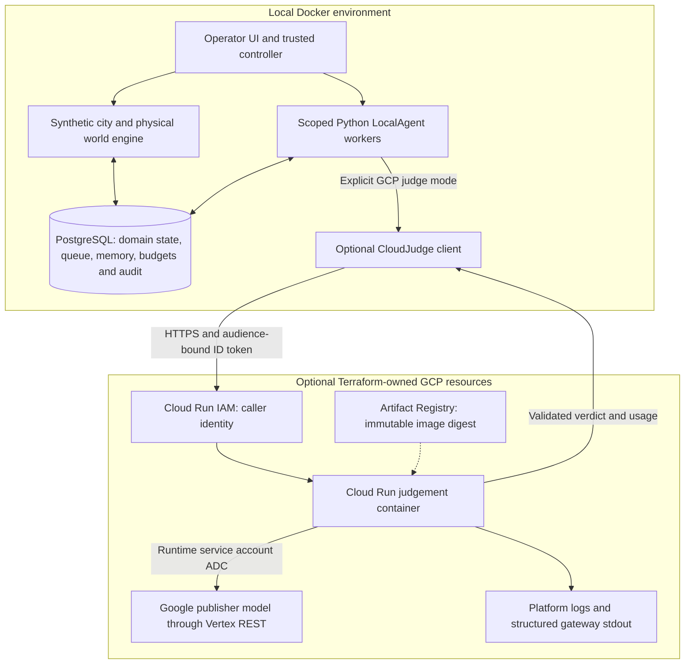
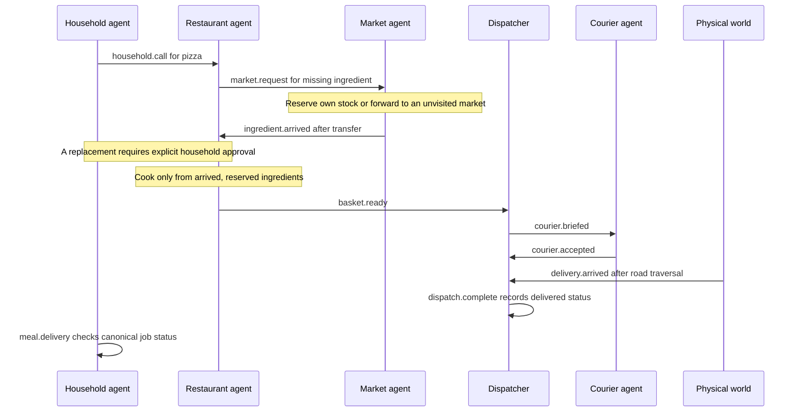

# Architecture overview

This project is a local engineering environment for studying bounded agent work:
ingredient sourcing, stock reservations, consent, courier assignment, physical
delivery and recovery. Its reusable runtime combines authenticated Python workers
with PostgreSQL transactions. Most decisions use fixed rules. A separately enabled
GCP recovery judge is the only Google model integration in the current design.

This chapter describes source reviewed on **2026-10-28**. It does not report a new
deployment or a current cloud inventory. Read [capability evidence](CAPABILITY-EVIDENCE.md)
for measured limits and [architecture decisions](ARCHITECTURE-DECISIONS.md) for
the alternatives behind these choices.

## Three boundaries

The **city boundary** owns virtual time, directed roads, congestion, courier
movement and recorded arrival. Agents request permitted transitions; they cannot
manufacture physical arrival. The **agent boundary** owns scoped observations,
approved tools, leased work and bounded recall. PostgreSQL is the authority for
stock, consent, custody and execution. Redis supports the local baseline but is
not the authoritative agent transport.

The **cloud boundary** accepts a bounded numeric recovery proposal and returns an
approve/deny verdict. It has no simulation database connection or execution tools.
Caller and runtime service accounts have separate duties. Cloud Run is reachable
over the public network with IAM-authenticated invocation; the Terraform module
does not provide private ingress. Cloud SQL, Pub/Sub, GKE, ADK, managed Agent
Runtime and Memory Bank are not deployed. See the [exact GCP inventory](GCP-COMPONENTS.md).

## What an agent actually is

`create_agent` produces the same frozen `LocalAgent` class for inventory,
fulfillment, dispatch, couriers, the recovery judge and supply entities. Its
inputs resolve to an authenticated scope, validated `RoleSpec`, definition hash
and restricted database connection. The public loop is `claim()` followed by
`process(event)`. Role-specific policies decide through `ScopedTools`; the factory
does not generate a new program for each fictional participant.

A trusted controller provisions the login and freezes the definition. SQL derives
scope from the authenticated database identity. Server-owned authority limits
tools, accepted topics and recipients. Editable names and SOUL text describe the
role; current deterministic policies do not interpret SOUL. Business settings
such as stock, opening hours, latency and numeric limits have implemented effects.
New roles still require code, database permissions and tests. The complete
[agent construction walkthrough](AGENT-IMPLEMENTATION.md) follows these steps.

For one event, an attempt/tool reservation commits first. The effects transaction
then validates the lease and authoritative payload, reads domain state and typed
recall, executes allowed actions, records the decision and outgoing events, and
ACKs. Those effects commit together or roll back together. Durable reservations
survive failure. This protects business effects without promising exactly-once
external inference or billing. Sources: [runtime](../src/delivery/agent_runtime.py),
[queue](../src/delivery/queue.py), [identity provisioning](../src/delivery/agent_access.py).

## Follow one household pizza request

This is a representative path with a pantry shortage, not a promise that every
seed follows it. Role handoffs use typed queued events; notes and self-steps
describe domain work.

The restaurant first checks menu, availability and pantry. Markets reserve
unreserved quantities atomically, or forward shortages through a bounded visited
list. A promised ingredient is unusable until arrival commits. A substitution
must satisfy the fixed rules, household exclusions and recorded consent before
cooking consumes the physical allocations once.

Cooking creates a delivery job and a dispatcher handoff. The courier must accept
its own briefing before departure; the world advances it along directed edges.
Ingredient transfer uses scheduled transitions rather than a separate moving
supplier vehicle. The restaurant-to-courier handoff **is implemented**; it is
covered by [delivery-fact regressions](../tests/test_supply_delivery_facts.py).

## Observability trace flow

Observability is disabled by default. One run-scoped order trace continues across
durable queue handoffs and lease retries. Explicit agent, ADK model and tool spans
record names, usage and estimated cost; FastAPI and Redis use OpenTelemetry
instrumentors. Exporters remove payloads and exception text before sending data.

The [Mermaid trace-flow diagram](ARCHITECTURE-OBSERVABILITY.md#trace-flow) follows
the API, persisted queue context, agent/tool spans and both export paths.

Trace and analytics flags are independent. Analytics outages do not change task
outcomes; Postgres and local receipts remain authoritative. The four BigQuery
tables have daily partitions, agent clustering and bounded retention. Saved SQL
deduplicates streaming rows before calculating cost per successful task, p95 tool
latency and eval pass^k trends. See [setup, privacy, reporting limits and
retention](ARCHITECTURE-OBSERVABILITY.md).

## Distinct workspaces and reading paths

The [restaurant workflow](RESTAURANT-SUPPLY.md) starts with household meal demand,
sourcing and consent, then reuses fleet delivery. The [delivery lab](FLEET-RECOVERY.md)
starts with stocked baskets and concentrates on fulfillment, contention, traffic,
dropouts and checkpoint recovery. They share infrastructure and some roles, but
their seeded scenarios and success criteria differ. The [inventory lab](AGENT-FOUNDATION.md)
isolates last-unit contention, delayed supply and worker crashes.

For a demonstration, open one restaurant order and inspect its call, ingredient
requests, actual memory revisions, queue lineage, cooking and physical handoff.
Then use a delivery-lab failure to inspect custody and the judge's limited
authority. Compare those observations with [local scenario evaluations](AGENT-EVALS.md).

For implementation, continue through [agent internals](AGENT-IMPLEMENTATION.md),
[memory](AGENT-MEMORY.md) and [GCP components](GCP-COMPONENTS.md). For a client or
interview discussion, use the [decision records](ARCHITECTURE-DECISIONS.md) and
[enterprise roadmap](ENTERPRISE-GCP.md). [Durable inference](DURABLE-INFERENCE.md)
now saves requests/results and invokes outside SQL connections, with local crash
verification. Controller recovery, workload identity, retention and measured
production release gates remain proposed work.
