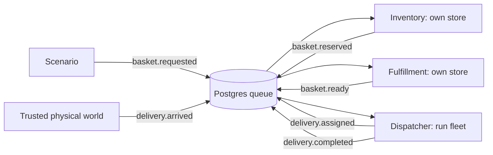

# Local basket-to-delivery slice

Implemented 2026-10-23. Open `/delivery-lab` and choose **Run basket delivery**.
The existing `/lab` last-unit/crash/delayed-supply scenario remains available.
Both use the same local factory, permissions, scoped tools, private memory,
durable budgets and fenced event-processing transaction.

```sh
docker compose exec -T app delivery delivery-demo
```

This runs a synthetic one-item basket on the 10×10 city, exports an evidence bundle
to ignored `artifacts/delivery-<run>.json`, and makes no model or provider calls.
The UI offers paced playback, a courier route, stage progress, role boundaries,
budgets, decision inputs and queue lineage. Its run URL survives reload. Downloaded
evidence includes consistent checkpoints, not a complete replay engine.

## Queue-only lifecycle



1. Inventory reserves one confirmed unit and emits an opaque basket reference.
2. Fulfillment validates the live own-store reservation, decrements on-hand and
   reserved stock together, writes one ledger movement and creates a ready job.
   The reservation becomes `picked`; repeated picking has no second effect.
3. Dispatch reads the logistics projection and selects an available bike. It
   plans connected roads from the courier's node through the store to the customer.
   The command independently validates endpoints, every directed edge and travel
   time, and atomically claims the courier. Concurrent jobs cannot claim one bike.
4. The world engine advances simulation time and the courier along those edges.
   It marks collection/in-transit/arrival and publishes `delivery.arrived`, linked
   to the assignment event. Agents cannot move the clock or manufacture arrival.
5. Dispatch confirms delivery only after authoritative arrival, releases the
   courier, marks the basket delivered and publishes the final queued result.

For seed 42, the bike travels from depot node 22 through pickup node 2 to customer
node 88. Collection occurs at simulation second 138 and arrival at second 1,016.
The UI uses individual edge travel times when placing the courier.

## Enforced role boundaries

| Identity | Permitted facts and actions | Denied access |
| --- | --- | --- |
| `inventory:store-N` | Own-store stock, reservations, replenishment and catalogue projection | Fulfillment commands, dispatch commands and other store/run state |
| `fulfillment:store-N` | Own reserved basket's SKU, quantity, expiry and picking status; atomic pick; queued ready handoff | Raw stock/catalogue/world/fleet tables, other stores, route assignment and delivery confirmation |
| `dispatcher:fleet` | This run's opaque ready jobs, road graph and courier availability; assign and confirm after arrival | Product identities, quantities, prices, stock, picking and fulfillment memory |

Five inventory and five fulfillment identities plus one dispatcher are provisioned
through separate non-superuser logins. Only three perform work in this small demo;
the other identities make the boundaries inspectable. Role namespaces are distinct
keys in the existing binding/budget/memory tables: inventory retains `store-N`,
fulfillment uses `fulfillment:store-N`, and dispatch uses `dispatcher:fleet`.

New roles have no direct table grants on inventory, fulfillment jobs or fleet.
Fixed security-definer projections/commands bind access to authenticated identity;
each command has role-specific execution grants. Event row security limits incoming
topics and destinations, and allows inspection of the identity's own outgoing
handoffs. Trusted destination rules route handoffs; policies cannot choose arbitrary
agents or stores. All messages retain the basket trace and parent event ID.

Definitions in `config/agents/{inventory,fulfillment,dispatcher}` are frozen per
run. JSON and soul text cannot grant another role's tools. Private expiring memory
and budget tickets use the same runtime as inventory. Default agent caps remain
100 attempts, eight slots per attempt, 400 slots per run and zero model spend;
the aggregate run cap remains 500 attempts and 2,000 slots.

The operator API/UI, fixed Python implementations and host are trusted, as documented
in [the foundation](AGENT-FOUNDATION.md). This is not an arbitrary-code sandbox.

## Verification and limits

The full Linux suite passes 76 tests, including nine new lifecycle/permission tests;
an additional operator API contract test passes separately. Ruff and mypy pass.
Chrome checks cover delivered stock, 100 nodes/360 roads, role boundaries, evidence
download, completed-run reload and desktop/mobile layout.

Tests include expired reservations, rollback of picking and its outgoing handoff
together, retry without duplicate consumption, forbidden direct table reads,
cross-store fulfillment denial, role switching, forged producers/destinations,
budget modification, hidden product data in dispatch, fabricated arrival,
disconnected routes and concurrent courier claims. Existing actual worker-crash
and Madrid regressions continue to pass.

This is a single-item, single-courier happy-path delivery slice. Continuous worker
supervision, controller restart recovery, cancellations/returns, arbitrary basket
expiry scheduling, cargo/energy constraints, traffic disruptions, multi-basket
dispatch waiting, architecture comparisons and full replay remain future work.
The world controller polls authoritative jobs as physical state; it does not call
another agent to complete work. Evaluated agents communicate through events only.
