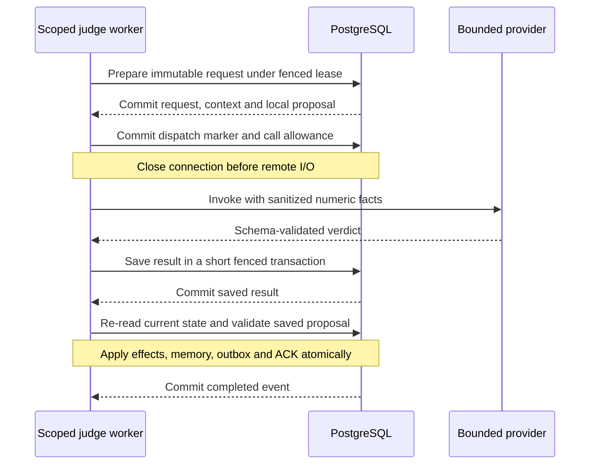

# Durable inference without open database transactions

The optional recovery judge uses three committed phases: prepare a request,
invoke and save a result, then apply it against fresh authoritative state. The
network call has no open worker database connection or transaction. Local rules,
role scope, leases and business constraints remain the execution authority.

This chapter describes the new local request/result protocol. It does not deploy
GCP resources or demonstrate live model quality. Crash verification uses a fake
provider and real worker-process termination; no paid calls are needed.

## Execution and transaction boundaries

The preparatory snapshot comes from the authenticated incoming event, the judge's
scoped tools and selective memory recall. It includes a locally computed courier
and route proposal. The durable record binds that input to its run, namespace,
source event, frozen role definition and endpoint. The cloud receives only the
existing numeric allowlist and the number of recalled facts; memory bodies,
customer names, local identifiers and raw route coordinates remain local.

Before dispatch admission, the worker rechecks context, simulated time and recalled
facts. It also verifies enough tool slots remain for the fresh recall and five
application operations. Known-stale preparation is denied before spending a call.
After the dispatch marker commits, all worker SQL connections are closed. Token
acquisition and the provider request happen outside the transaction. A separate
short transaction saves the validated response. `Queue.process` then starts its
usual effects transaction, reloads the authoritative event, validates its fence,
reads current business state and consumes the saved result. The deterministic
policy does not call the provider from inside this transaction.

## Recovery policy

| Durable state at restart | Recovery | Additional provider call |
| --- | --- | --- |
| Prepared, dispatch not claimed | A live fenced worker may claim dispatch | One admitted call |
| In flight under another still-active worker | Leave ownership intact; report busy | None |
| Dispatch committed, previous worker died | Record an unknown outcome and fail closed after reclaim | None |
| Response received but result not saved | Outcome remains unknown after worker death | None |
| Validated result saved, effects not committed | Reuse the saved result and revalidate current facts | None |
| Effects transaction crashed before commit | Roll back effects, memory, outgoing events and ACK; reuse result on reclaim | None |
| Applied and acknowledged | Work is complete; a stale worker cannot apply again | None |
| Legacy call with no durable snapshot | Preserve its allowance and deny; old inputs cannot be proven compatible | None |

Prepared requests and saved results are keyed by the source event, not by a queue
delivery attempt. Reclaiming an event therefore does not create a second model
call or reserve a second model allowance. A genuinely new decision event remains
a separate admission. Reservations for uncertain calls are retained.

An approval is a proposal about the saved facts. The application phase rechecks
the current job, delivery attempt, custody, courier availability, route and
deadline. A stale or incompatible proposal is rejected. The model cannot invent
a replacement route or override the SQL feasibility gates.

## What safe retries can and cannot mean

There is no distributed transaction between PostgreSQL and a model provider.
The worker cannot distinguish a crash immediately before sending from a crash
after the provider accepted the request but before its response was recorded.
A stable local request key does not prove provider-side deduplication or
exactly-once billing. The implementation deliberately avoids automatic resend
across this uncertain boundary.

This policy trades availability for bounded spend and safe business effects.
Unknown outcomes require a denial or an explicit future reconciliation workflow;
they are not silently retried until an answer arrives. A future provider that
offers an idempotent request API and durable result lookup could support a
different recovery policy, after its behavior and billing semantics are tested.

## Isolation, budgets and evidence

Raw request and history tables are not agent-readable. Narrow SQL functions
derive scope from `session_user`, require the current event lease and budget
ticket, and fence dispatch/result/application transitions. A stale worker cannot
overwrite a newer terminal outcome. Recorded errors use safe codes, not provider
exception messages that might contain credentials.

The original per-run model call and token limits still apply. Dispatch admission
charges a request once; reusing its saved result does not charge another call.
This remains a call/token allowance, not a project-wide currency cap. The
existing GCP gateway and Terraform resources do not change for this local work.

The [crash suite](../tests/test_inference_crash_recovery.py) checks physical process
death at the phase boundaries, saved-result
reuse, uncertain-outcome denial, lease fencing, concurrent ownership, unchanged
business effects and the absence of worker SQL transactions during provider I/O.
Use the [health dashboard](HEALTH.md) for fresh source-linked test evidence and
[architecture decisions](ARCHITECTURE-DECISIONS.md) for the remaining trade-offs.
The implementation lives in [durable_inference.py](../src/delivery/durable_inference.py),
the [new SQL state machine](../sql/migrations/016_durable_inference.sql),
the [shared worker](../src/delivery/agent_runtime.py) and
[receipt-only policy](../src/delivery/fleet_policy.py).
