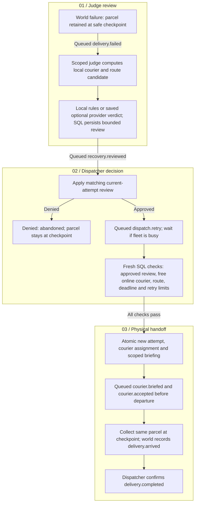

# Multi-basket fleet and judged recovery

The fixed `delivery delivery-demo` runs the local 32×32 synthetic scenario below.
The default `/delivery-lab` now uses [configurable running-city sessions](RUNNING-CITY.md);
saved fixed runs remain inspectable in the map UI. Existing saved 10×10 runs and the separate `/lab` inventory
crash/replenishment exercise retain their earlier behavior.

The expanded city has 1,024 nodes, 3,968 directed adjacent roads and 12 establishments:
six supermarkets, three retail stores and three pharmacies. Pharmacy catalogue
rows are simulated hygiene goods. They contain no patient, prescription or medical
decision data. Opening inventory is one or two units per stocked product.

## What the seeded scenario demonstrates

Seven one-item basket requests compete for stock and four bike couriers. Three
couriers start online; the fourth becomes available as a replacement at simulation
second 180. Two baskets compete for the same last unit, so one is rejected. Six
parcels are picked exactly once.

Persistent seeded congestion doubles every directed road's traversal time.
Route validation and physical motion use the same per-edge durations. At second
180 two couriers suffer simulated mechanical failures. Each parcel stays at the
last reached safe checkpoint. A replacement must travel there and collect it;
the system never returns it to a store or consumes another stock unit.

For seed 42, the judge approves recovery of `delivery-a` and denies `delivery-b`,
whose deliberately tight delivery window has already expired. The approved parcel
receives attempt two and a new courier. The final result is five delivered baskets,
one abandoned parcel held at its checkpoint and one rejected stock request.
Abandoned is an explicit failure outcome, not a successful delivery or vanished stock.

## The call is a queued briefing

This demo simulates the call with a scoped queued message. It makes no telephone,
voice-provider or model calls. Dispatch sends `courier.briefed`; the selected courier
agent reads its current briefing and sends `courier.accepted`. Physical departure
cannot precede acknowledgement. If acknowledgement is delayed, departure, pickup
and arrival times move together rather than inventing travel during that delay.

Recovery follows this queue and physical-custody boundary. The fixed scenario
uses local rules. A separately enabled judge can consume a saved provider verdict
through the [durable inference protocol](DURABLE-INFERENCE.md); the same execution
gates remain in force.

All role-to-role handoffs use the durable event queue. A self-queued dispatch retry
waits when all online couriers are busy. No role directly calls another role.
The trusted scheduler activates only the appropriate authenticated worker; it does
not pass the operator snapshot into an agent.

## Relevant memory without sharing private memory

A recovery brief is an immutable, run/basket/attempt-scoped export of canonical
facts: objective, custody checkpoint, customer node, prior courier/attempt, failure
reason, source event references, judge verdict, deadline and route. It contains
neither product/price information nor another agent's private episodes, soul or
transcript. The selected courier can read its own current brief; another courier
cannot retrieve or accept it. Old attempt messages cannot mutate the replacement
attempt.

Private expiring agent memory remains in its existing authenticated namespace.
Shared briefs, incidents and reviews are separate operator-owned records accessed
through narrow role projections. An exported brief does not grant access to the
source event bodies or the source agent's memory.

## Judge and permission gates

The judge is a deterministic operational role, distinct from a future external eval
scorer. It sees the failed logistics job, current custody, available online couriers
and traffic-adjusted roads. It cannot inspect stock or product data, assign couriers,
move parcels or confirm delivery.

The database independently recomputes the proposed route. A retry needs an online
free courier, a matching current-attempt review, enough remaining deadline, fewer
than two total attempts, and at most 100 simulated route-minutes. Dispatch rechecks
these limits at assignment time. A prompt or forged verdict event cannot replace
the persisted review. Route-minutes are a synthetic retry-cost proxy, not money.

Thirty independently scoped logins cover 12 inventory roles, 12 fulfillment roles,
four courier roles, one dispatcher and one judge. Courier and judge logins cannot
read raw operational tables or execute another role's commands. Legacy command entry points cannot be called by agents to bypass the expanded checks. The host, fixed Python policy
code and operator interface remain trusted; arbitrary agent-written Python is not
sandboxed by these database boundaries.

Dispatcher limits are explicitly configured at 150 attempts and 1,200 reserved
tool slots for the larger scenario. Other role defaults remain 100 attempts and
400 slots. The aggregate cap remains 500 attempts and 2,000 slots; model caps remain
zero. Durable reservations are not refunded on crashes or replayed attempts.

## Evidence and current limits

The inspector exposes current routes, online/offline fleet state, traffic and dropout
incidents, judge reasons, custody briefs, attempt history, budgets and event lineage.
Arrival/collection timeline entries come from recorded physical observations, not
obsolete planned timestamps. Evidence exports retain checkpoints and conserved stock.

The full Linux suite passes **86 tests**, Ruff and mypy. Chrome checks pass for
city counts, both judge verdicts, custody briefing provenance, evidence download,
completed-run reload and desktop/mobile layout.

Verification covers two independent dispatcher workers claiming different queued
jobs while competing for one online bike: one assigns, the other defers. It also
covers cross-courier briefing denial, cross-role command denial, missing-review
denial, acknowledgement timing, stock conservation, custody tracking and both judge
outcomes. Existing Madrid, inventory crash and legacy delivery tests remain part
of the regression suite.

Freshly published events are immediately wall-clock eligible; simulation due time
still controls scheduling. Wall-clock retry backoff and leases remain enforced.
This prevents transaction timestamps or clock adjustments from making fresh events
temporarily invisible and changing a seeded run's initial assignments.

Still deferred for this fixed scenario: real voice calls, live traffic, arbitrary incidents,
road-capacity queues, cargo/energy constraints, cancellation/returns, controller
restart recovery, full replay and published multi-seed architecture comparisons.
