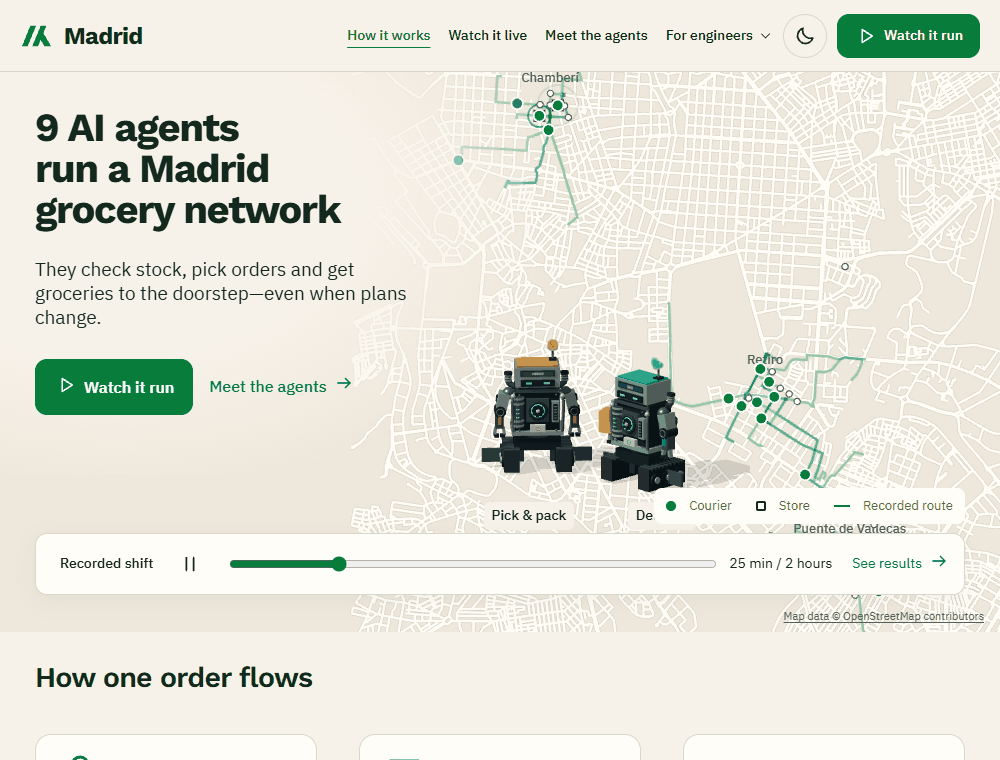
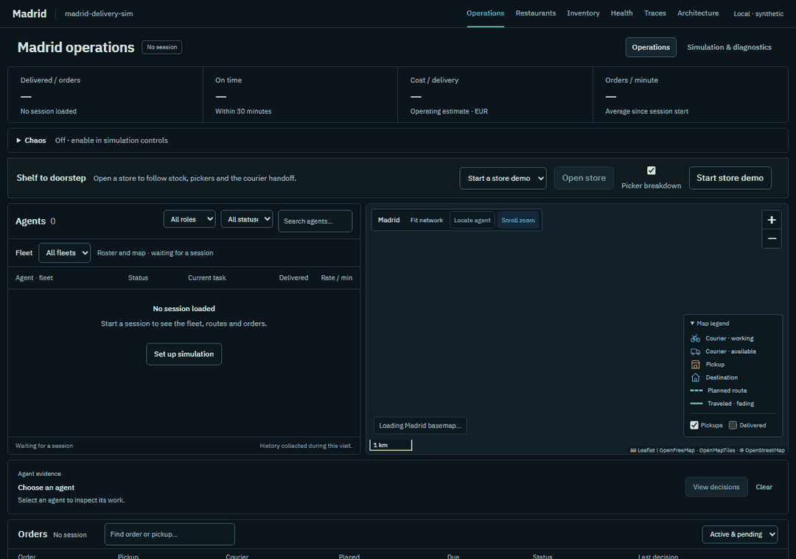
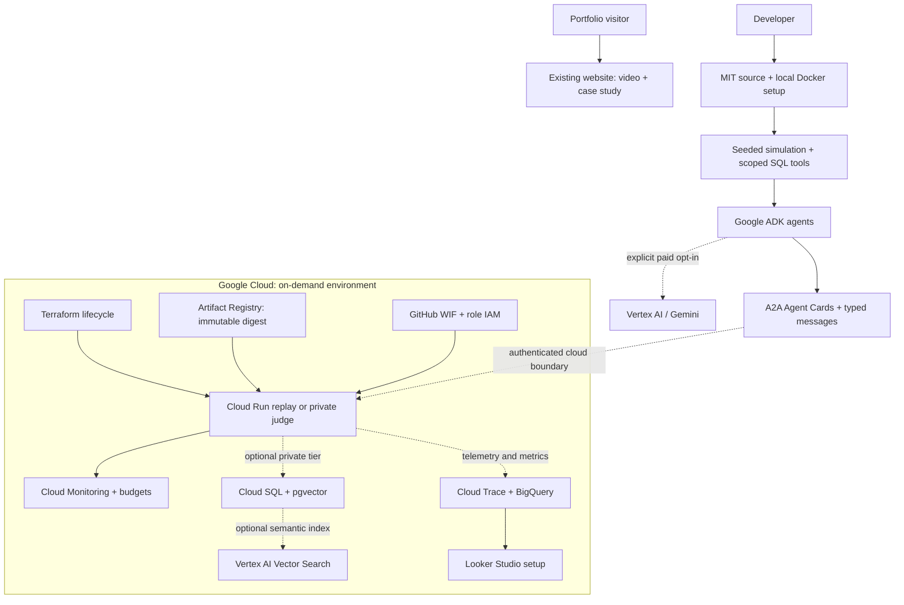

# Madrid delivery sim — agents built for Google Cloud

Nine agent roles coordinate a simulated Madrid grocery network, from stock
reservation and store picking to courier delivery and disruption recovery.
This is an engineering portfolio project: watch the recordings, inspect the
design, or run the MIT-licensed code in your own environment.

**[Watch the demo and read the project](https://me.alejandrofranks.workers.dev/projects/madrid-delivery-sim)**
· [Source](https://github.com/alejandrofrank/madrid-delivery-sim)
· [Run locally](../README.md#run-it-yourself)

The portfolio serves recordings and documentation. It does not start simulations,
connect to private databases or make model calls. Cloud resources are created
for bounded verification sessions and removed afterward.

## What to watch

Inventory reserves a basket, fulfillment picks and packs it in the 3D store, and
the dispatcher assigns a courier. A disruption changes the facts; scoped agents
choose recovery actions through their normal tools. Decisions, policy enforcement
and outcomes remain inspectable.

These are existing browser recordings of seeded, synthetic runs. Default replay
and CI use scripted offline ADK fixtures and deterministic policies. Separate
paid Vertex checks establish the narrower live-model evidence below.

## Where Google Cloud fits

| Layer | Technology | What it demonstrates |
| --- | --- | --- |
| Agent implementation | Google ADK; optional Gemini through Vertex AI | Real ADK runners and scoped function tools. Native Vertex restaurant turns and a bounded recovery judge have dated live evidence. |
| Communication | A2A; Google ID tokens on GCP | Agent Cards and typed requests; audience-bound authentication and separate cloud role identities. MCP exposes four read-only queries. |
| Deployment | Cloud Run, Artifact Registry, Terraform | Immutable replay image deployed, HTTP/browser checked, then removed. Scale-to-zero and teardown are part of the lifecycle. |
| CI identity | Workload Identity Federation and IAM | GitHub main/environment/workflow restrictions and short-lived identity, without service-account JSON keys. Deployment requires CI and the held-out gate. |
| State and memory | Cloud SQL/PostgreSQL with pgvector; optional Vertex AI Vector Search | SQL owns scope, TTL and audit. Local pgvector is tested; the private cloud tier remains unqualified. |
| Operations | Cloud Trace, BigQuery, Cloud Monitoring; Looker Studio | Trace/export integrations, metric views and dashboard/SLO setup. The private production dashboard path still needs qualification. |

ADK is the framework; Vertex AI is an optional model provider. A2A and MCP are
protocols, not proof that every role uses a language model. Routine stock and
routing policies can run without one.

## Architecture

The public website does not call the cloud runtime. This diagram includes optional
infrastructure; verification scope is explicit below.

## What has actually been verified

| Evidence | Result | Scope |
| --- | --- | --- |
| [Cloud Run replay](evidence/production-verification.json) | Deployed, playback checked, writes rejected, torn down | Dated deployment evidence, not an always-on service or a claim that today's UI was redeployed. |
| [Native ADK on Vertex](evidence/adk-restaurants-vertex.json) | Both documented restaurant SOULs exercised with the live provider | Bounded integration checks, not a representative quality benchmark. |
| [Private Vertex judge](GCP-VERIFICATION.md) | Initial 4/6 toy cases; repaired system passed 6/6 | Final result: one model decision, five deterministic policy denials. Failure and repair preserved. |
| [Held-out receipt](evidence/heldout-release.json) | 72 cases × five attempts; 360/360 passed; pass^5 = 1.000 | Scripted offline contract/policy checks. The all-pass bootstrap interval does not establish certainty on new workloads. |
| [Seeded A2A Chaos shift](evidence/a2a-chaos-local.json) | 71/71 delivered; €1.7215 simulated operating cost per delivery | Synthetic economics, not model spend or a cloud bill. Recovery includes completing affected deliveries. |
| [Current CI](https://github.com/alejandrofrank/madrid-delivery-sim/actions/workflows/ci.yml) | Python, browser, movement, Terraform and eval checks | Follow the run for the exact revision; historical receipts retain their dates. |

The private full-stack deployment is not production-qualified. Least-privilege SQL
controller bootstrap, private Cloud SQL/Vector Search validation, interactive
browser login and multi-instance recovery remain documented work.
[Deployment limits](production/DEPLOYMENT.md#optional-private-live-qualification).

## Engineering decisions

- **Decisions are separate from permission.** Models propose through tools; SQL
  checks ownership, physical stock, delivery custody, policy and budgets.
- **Retries leave evidence.** Durable queues, staged effects and receipts prevent
  duplicate business effects. Ambiguous paid attempts fail closed.
- **Memory is scoped evidence.** Run, role, order, expiry and provenance are
  enforced outside the model, including semantic recall candidates.
- **Protocols define boundaries.** A2A services expose Agent Cards; an in-process
  transport preserves isolated tests. MCP reads expose approved facts.
- **Failure is part of the demo.** Rain, strikes, outages, courier loss and store
  disruptions exercise recovery and policy compliance.
- **Cloud spend is deliberate.** Default demos need no API keys. Paid inference
  is explicit and bounded; Terraform removes runtime resources after a session.
  Delayed budget enforcement is not a total-cost guarantee.

## Read the implementation in layers

1. [Agent anatomy and memory explorer](AGENT-ANATOMY.md) — interactive locally at /agents.
2. [Agent implementation](AGENT-IMPLEMENTATION.md) — how decisions become effects.
3. [Google ADK restaurant](ADK-RESTAURANT.md) — tools, sessions and Vertex admission.
4. [GCP components](GCP-COMPONENTS.md) — resources, identities and ownership.
5. [Trust model](production/TRUST-MODEL.md) — authentication and authorization.
6. [Semantic memory](production/SEMANTIC-MEMORY.md) and [metrics/SLOs](production/DASHBOARDS.md).
7. [Deployment and teardown](production/DEPLOYMENT.md) — use your own project and billing.

## Run and reuse

Use the local Docker setup in the README. It uses synthetic data and no paid
models. Google Cloud is an explicit optional path with your own project,
identities and billing. Historical project IDs in receipts are evidence, not
deployment targets.

Original code is [MIT licensed](../LICENSE). Assets and dependencies retain their
[third-party terms](../THIRD-PARTY-NOTICES.md). This is a portfolio and learning
project, with no hosted-service or support SLA.
