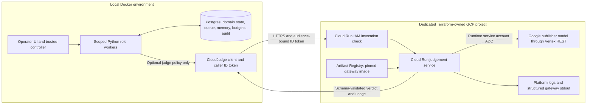

# GCP components: exact implementation and ownership

Source review: 2026-10-28. These are the resources and call paths defined by this
repository. No cloud resources were started or queried for this documentation
change. Last live lifecycle evidence is dated 2026-10-25 in
[GCP verification](GCP-VERIFICATION.md): the dedicated project was ACTIVE, billing
disabled and billable demo runtime removed. Run the documented status command to
check a later session; do not treat a source review as a fresh cloud inventory.

## Architecture as built



Inventory, restaurants, dispatch, courier motion, canonical memory and the durable
queue run locally. Redis is a local baseline support service; it is not the
authoritative agent transport. There is no Cloud SQL, Pub/Sub, GKE, managed agent
runtime, managed Memory Bank or ADK deployment in this Terraform root.

## Terraform resource inventory

[main.tf](../infra/gcp-ai/main.tf) is the only cloud infrastructure root for this
demo. It requires Terraform 1.6+ and Google provider `~> 7.0`; the committed provider
lock file resolves an exact selected build. State is local to this root and ignored
by Git. Scrapmarket's project, backend and credentials are not imported or reused.

| Terraform address | Purpose and actual configuration | Retained when parked? |
| --- | --- | --- |
| `google_project.ai` | Dedicated project; no default network; application labels; `deletion_policy=PREVENT` and `prevent_destroy=true` | Yes |
| `google_project_service.api["run.googleapis.com"]` | Cloud Run administration API | Yes |
| `google_project_service.api["artifactregistry.googleapis.com"]` | Container repository API | Yes |
| `google_project_service.api["aiplatform.googleapis.com"]` | Google model inference/token-counting API | Yes |
| `google_project_service.api["iam.googleapis.com"]` | Service-account/role administration | Yes |
| `google_project_service.api["iamcredentials.googleapis.com"]` | Short-lived impersonated credentials | Yes |
| `google_project_service.api["cloudresourcemanager.googleapis.com"]` | Project lifecycle/metadata | Yes |
| `google_service_account.judge[0]` | `judgement-runtime`, attached to the Cloud Run service | Yes |
| `google_project_iam_custom_role.judge_predict[0]` | `boundedJudgePredict`: only `aiplatform.endpoints.predict` | Yes |
| `google_project_iam_member.vertex[0]` | Grants that custom prediction role to the runtime account | Yes |
| `google_service_account.caller[0]` | `judgement-caller`, separate invocation identity | Yes |
| `google_service_account_iam_binding.caller_tokens[0]` | Explicit operator/service principals may impersonate the caller via `roles/iam.serviceAccountTokenCreator` | Yes |
| `google_artifact_registry_repository.images[0]` | Regional Docker repository `judgement`; image storage can cost money | No |
| `google_cloud_run_v2_service.judge[0]` | Regional stateless `judgement` endpoint | No |
| `google_cloud_run_v2_service_iam_binding.invoker[0]` | Only the caller service account receives this service's `roles/run.invoker` binding | No |

That is **12 retained foundation resources**, plus **3 runtime resources** when
fully enabled. Provider-managed service agents, service revisions and platform
audit records are not independent resources declared in this root. The project
IAM binding is additive; the service-account/service bindings are authoritative
for their respective roles. Shared-project IAM must not be managed accidentally.

The invoker member validation accepts explicit user/service-account principals,
not public principals. The current Cloud Run setting is nevertheless
`INGRESS_TRAFFIC_ALL`: the HTTPS endpoint is network-reachable, with IAM protecting
invocation. **Authenticated invocation is not private network ingress.** There is
no VPC, IAP front end, Agent Gateway or Model Armor resource in the deployed module.

## Service sizing, build and model configuration

| Setting | Current code |
| --- | --- |
| Container | Python 3.12 slim, locked Python dependencies, FastAPI/Uvicorn, UID/GID 65532 |
| Contents | Gateway source, meal-snapshot validator and synthetic `data/meal-snapshot.json`; no database exports or agent credentials |
| Build | Local Docker `linux/amd64` build; no Cloud Build job or staging bucket |
| Image | Local push to Artifact Registry; lifecycle helper verifies a single repository digest and deploys the immutable `@sha256` reference |
| CPU / memory | 1 vCPU / 512 MiB; request-based CPU allocation, startup boost off |
| Scaling | Service and template minimum 0, maximum 1; concurrency 4 |
| Request timeout | Cloud Run 35 seconds; local caller 30 seconds |
| Gateway input/output | Strict Pydantic objects; 8,192-byte assembled request bound; 256 maximum output tokens; bounded response reads |
| Vertex transport | REST `:countTokens` followed by `:generateContent`, authenticated using runtime ADC |
| Token/request timing | Token count timeout 5 seconds, generation request timeout 15 seconds; successful response usage is checked |
| Thinking / output | `MINIMAL`, JSON MIME type, two-decision response schema; these settings require a compatible model |
| Runtime environment | `GOOGLE_CLOUD_PROJECT`, `VERTEX_REGION`, `VERTEX_MODEL` |

Sources are [Dockerfile](../infra/gcp-ai/Dockerfile),
[gateway.py](../infra/gcp-ai/gateway.py),
[variables.tf](../infra/gcp-ai/variables.tf) and
[gcp_demo.py](../scripts/gcp_demo.py). Terraform requires explicit region, model
location and model identifier; this documentation does not read private variable
files. Historically verified values were Cloud Run `europe-west1`, Vertex
`global`, and `gemini-3.5-flash-lite`. That deployment is **not** an EU-only
inference processing claim. Returned model version and gateway revision are more
useful experiment provenance than a model-family label alone.

Zero minimum instances is a demo cost/latency choice, not an availability SLO or
guarantee of no storage/logging/inference charges. Configured maximum instances
and concurrency constrain capacity, not total spend. See
[Cloud Run billing behavior](https://docs.cloud.google.com/run/docs/configuring/billing-settings).

## Authentication, step by step

1. An explicitly cloud-enabled local run freezes its gateway origin. Base Compose
   does not mount cloud credentials. The opt-in
   [Compose override](../compose.gcp-ai.yaml) mounts the operator's ADC directory
   read-only; it is never copied into an image or Git.
2. `identity_token` in [cloud_ai.py](../src/delivery/cloud_ai.py) uses ADC to
   impersonate `judgement-caller`, obtaining an ID token whose audience is the
   gateway service origin. The client accepts only a Cloud Run HTTPS origin.
3. Cloud Run checks that token and its service-level invocation policy before
   FastAPI handles `/judge`. The application relies on this platform authentication;
   it does not independently validate arbitrary JWTs or enforce per-tenant quotas.
4. Cloud Run executes as `judgement-runtime`. Runtime ADC provides OAuth access
   to the Google publisher model through its prediction-only custom role. No
   downloaded service-account key or model API key is needed.
5. The cloud runtime has no simulation database connection or business action
   tools. It returns a verdict; local SQL still decides whether any retry is legal.

The custom role is prediction-only at **project** scope, not an IAM allowlist for
one model ID. The configured model is an application-controlled selection. The
caller impersonation role can mint more than ID tokens; a client deployment should
test whether its actual flow can use a narrower grant. Neither current account is
a managed Agent Identity with runtime-bound agent credentials.

This follows the distinction between caller ID tokens and runtime service identity
in Google's [authenticated invocation](https://docs.cloud.google.com/run/docs/authenticating/service-to-service)
and [service identity](https://docs.cloud.google.com/run/docs/configuring/services/service-identity)
guides. Local ADC is a development credential flow. Enterprise CI should use
restricted Workload Identity Federation, not a copied user ADC file.

## Exactly what reaches the model

`sanitized_request` permits finite numeric values for `attempt`, `retry_limit`,
`deadline_sim`, `sim_time` and optional `cost_eur`; a candidate contains only
`estimated_seconds`, `remaining_seconds` and `route_nodes`. It sends the number
of recalled entries, capped at 100, **not their bodies**. Customer names, order IDs,
courier IDs, route coordinates, local SOUL and private Bakiano rows are omitted.

The gateway adds its packaged seven-meal, seventeen-ingredient, three-fictional-
market snapshot. Its fixed prompt permits only `approve_retry` or `deny_retry`
with a short reason; it exposes no tools. Snapshot and prompt versions are logged.
This is read-only reference for pizza, kebab, hamburgers, steak frites, sushi, soups
and salads; the judge does not procure ingredients or substitute a meal.

Before inference, deterministic preflight denies absent/invalid numeric facts,
missing candidates, exhausted retries and infeasible deadlines/route duration.
The 6,000-second route threshold is a simulation step/duration bound, **not a GCP
monetary budget**. A JSON-conforming answer is still subject to local feasibility
and custody checks. Authentication, transport or validation failure denies the
AI-enabled retry. No silent switch to local approval is made within that run.

The configured cumulative allowance is six calls/50,688 tokens per run. Each
admitted attempt separately reserves 8,448 tokens; the whole allowance is not
reserved upfront. This does not enforce a project-wide currency budget,
block another authorized direct caller, or guarantee exactly-once model billing.
The cloud judge currently waits inside the local queue effects transaction;
see the explicit [implementation limitation](AGENT-IMPLEMENTATION.md).

## Observability and its current limits

Gateway structured stdout records event class, decision, prompt version, snapshot
hash, Cloud Run revision and, for actual model answers, model version, token usage
and elapsed milliseconds. Preflight denials record zero model tokens. Local model
audit records attach provider/verdict/usage/error class to the event attempt.

Platform request/audit logging and gateway stdout are available, but Terraform does
not configure custom log retention, dashboards, alert policies, Cloud Trace spans
or OpenTelemetry export. There is no complete distributed trace from the local
order through Cloud Run/Vertex: correlation IDs are deliberately excluded from the
model body, and a separate sanitized tracing propagation channel remains to be
added. Do not describe the local event inspector as deployed Cloud Trace or as
access to a model's private reasoning.

## Start, inspect and park

These are operational commands, **not steps required to read this documentation**:

```bash
make gcp-start
make gcp-status
make gcp-stop
```

`start` verifies prerequisites, links billing with runtime enabled/gateway disabled,
builds/pushes the image, then deploys the gateway and reconnects the local app.
It enables the UI option but does not select it or initiate inference. `status`
reads project/billing/service/state information and never links billing merely to
inspect Artifact Registry. That check is reported unavailable when billing is off.

`stop` first attempts to restore base local Compose, then removes the service,
invoker binding and image repository **while billing is still linked**. A second
Terraform apply unlinks billing. Project, APIs and IAM identities remain. The helper
validates saved plans against phase-specific resource/project allowlists and uses
a local lifecycle lock. Shutdown failure is explicit; it is not reported as parked.

Ordinary `terraform destroy` is intentionally blocked by project protection.
This implements the later requirement to preserve project/IAM between sessions.
Full project erasure is a separate reviewed lifecycle change, not the daily stop
command. Prior invoices, delayed usage reporting and retained platform audit
records are not erased. The helper controls this root's resources, not arbitrary
resources created manually or in another project.

Cloud SQL, remote Terraform state buckets, secrets, managed memory, traces and any
future paid service must have an explicit owner, Terraform coverage and stop/data-
retention policy before adoption. A production retention requirement can introduce
an intentional cost floor; it must never be advertised as a free parked demo.
See [the complete operations runbook](GCP-AI.md).
