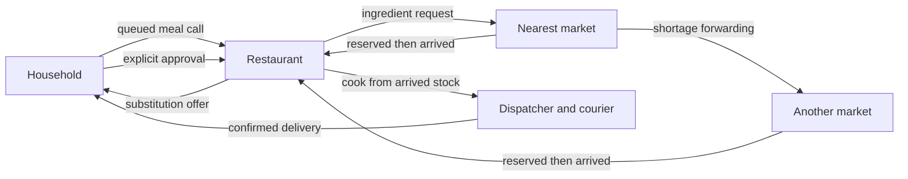

# Local restaurant supply simulation

This lab follows a household meal request through ingredient sourcing, cooking,
and courier delivery in the fictional 32×32 city. The household, restaurant, and
market workers run deterministic local rules. No model account, voice service,
provider key, or paid inference is required. The simulated phone conversations
are text records and queue messages; they do not place telephone calls.

The starting city contains 128 synthetic households, seven restaurants, and three
ingredient markets. Its homes come from the existing urban fixture. Each
restaurant initially serves one recipe from `data/meal-snapshot.json`:

| Recipe ID | Meal |
| --- | --- |
| `pizza` | Pizza |
| `kebab` | Kebab |
| `hamburgers` | Hamburgers |
| `steak-frites` | Steak frites |
| `sushi` | Sushi |
| `soups` | Soups |
| `salads` | Salads |

`market-a`, `market-b`, and `market-c` occupy the map nodes of `store-1`,
`store-5`, and `store-10`. Their ingredient role belongs to this simulation;
the older shop categories do not define their permissions here.

## Editable blueprint and frozen run

The blueprint is the saved configuration for the next run. Saving a draft changes
that blueprint and its revision. Starting a run freezes the selected configuration,
its canonical SHA-256 digest, the entity definitions, opening stock, and agent
definitions for that run. Later blueprint edits do not rewrite running or saved
orders, inventory, identities, or evidence. A revision check prevents a stale editor
from silently replacing a newer blueprint.

An entity is a household, restaurant, or market with its own ID and node. Its
editable definition includes:

| Field | Meaning |
| --- | --- |
| `id`, `name`, `kind`, `node` | Stable reference, display name, one fixed entity kind, and grid node 0–1023 |
| `recipe_ids` | Restaurant menu or household meal preferences; markets have no prepared-meal menu |
| `opening_hours` | Local daily availability as `{ "start": 11, "end": 23 }` |
| `order_hours` | Household call windows, initially lunch 12–14 and dinner 19–21 |
| `allow_substitutions` | Whether the household may approve a proposed ingredient alternative |
| `excluded_ingredients` | Canonical ingredient IDs the household excludes |
| `agent` | Optional complete agent definition for this entity; `null` inherits its role template |
| `opening_stock` | Restaurant/market overrides by canonical ingredient ID, in whole grams, millilitres or pieces; 0–100000 per ingredient |

Hours are integer local hours with an inclusive start and exclusive end. `0–24`
means all day; `23–2` continues through midnight. Equal start and end are rejected.
Definitions require unique entity IDs, canonical recipe and ingredient IDs, and at
least one household, restaurant, and market. The city admits at most 160 entities.

The `agents` object has exactly three templates: `household`, `restaurant`, and
`market`. Each has `display_name`, `soul`, `latency_seconds`, `limits`, and `search`. A template
edit applies to entities that inherit that template in the next run. An entity
override applies only to that entity. Removing the override restores inheritance.

Display names and SOUL text are stored and versioned descriptions. The present
rules do not ask a model to interpret SOUL text. Timing and budget fields have
executable effects; editing a description does not add a decision procedure or
grant permissions. Entity kind determines the role, and the server owns its tools,
topics, identity, and recipients. Unknown fields and attempted tool or role
injection are rejected by the strict definition models.

## Finite demand and timing controls

| Setting | Default | Accepted range |
| --- | --- | --- |
| `seed` | 42 | 0–2³¹−1 |
| `duration_minutes` | 120 | 15–1440 |
| `start_hour` | 11 | 0–23 |
| `playback_seconds` | 60 | 0–120 |
| `calls_per_household` | 1 | 0–3 |
| `communication_latency_seconds` | 5 | 0–120 |
| `supplier_delay_seconds` | 60 | 0–1800 |
| `restaurant_stock_servings` | 0 | 0–10 |
| `market_stock_servings` | 3 | 0–20 |
| `fleet_couriers` | 6 | 1–16 |

Each household has an independent seeded random sequence for its calls. The
scheduler intersects its order windows with its own availability and the opening
hours of restaurants offering a preferred meal. It produces at most **64 calls
for the whole run**, even when more households are configured. The 128 homes are
potential participants rather than a promise of 128 calls. Zero calls is valid.

Each scheduled call includes a stable order ID, household, restaurant, meal,
quantity one, simulated arrival time, delivery deadline, customer node, and a
human-readable request transcript. The deadline is two simulated hours after
the call. Future schedules belong to the operator; they do not give agents
advance knowledge of future orders.

Communication latency and an entity's resolved agent latency are additive. With
both defaults set to five, a normal communication handoff takes ten simulated
seconds. They change queue due times rather than making worker threads sleep.
Playback controls the pace at which the operator watches the simulation; it does
not change ingredient quantities, message order, or road traversal rules.

Supplier delay models the wait between reservation and dispatch. The ingredient
arrival is a later queued transition. Stock promised by a supplier is not usable
in the restaurant until that arrival commits. This slice does not simulate a
separate supplier vehicle moving along the map. The last mile uses the existing
dispatcher and courier system on directed city streets.

## Meal and ingredient lifecycle



1. A due household intent queues a call to its selected restaurant. The
   restaurant checks that it offers the requested recipe and is open when the
   call is handled.
2. The restaurant reserves available ingredients from its own pantry and creates
   separate requests for shortages. It sends each request to a selected nearby
   market. The recipe and its quantities come from the validated meal snapshot.
3. A market checks its own unreserved stock for the requested ingredient and
   canonical unit. A full available quantity is reserved atomically. A shortage
   forwards the request to another unvisited market; the visited list prevents
   loops and the hop bound ends an unsuccessful search.
4. A reservation schedules transfer and subsequent arrival. The market's physical
   stock decreases on dispatch; the restaurant receives and reserves the actual
   ingredient on arrival. The order cannot cook from a reservation, an ETA, or an
   in-transit promise alone.
5. When sourcing fails, a fixed substitution table may offer a compatible-unit
   alternative. Exclusions still apply. The offer goes to the actual household
   as an event, and its reply must approve the proposal before the restaurant
   sources the alternative. Declining, an unsafe alternative, exhausted suppliers,
   or deadline expiry fails the order and releases applicable reservations.
6. Cooking consumes the restaurant's reserved physical allocations once, creates
   a ready delivery job, and queues the dispatcher handoff. Delivery becomes
   complete only after the existing courier workflow reports delivery.

The fixed alternatives and exclusion checks are synthetic business rules. They
are not a nutritional, allergy, or medical assessment. Editing SOUL text cannot
invent an alternative or bypass consent.

Stock quantities retain their canonical units: grams (`g`), millilitres (`ml`),
or count (`piece`). The code rejects unit mismatches instead of treating a piece,
gram, and millilitre as interchangeable. Stock uses the indexed tuple
`(run_id, owner, ingredient)` as its primary key; order and request indexes cover
household, restaurant, market, and order lookups. Finding a row is a database
operation. The scenario does not need semantic search or a model to look up
inventory.

## Agent authority and queue boundary

Every supply entity gets a separate temporary PostgreSQL login. Its authenticated
binding fixes the run, entity namespace, role definition hash, private memory,
and durable budget. Agents receive scoped tools rather than the operator's
database connection or whole-city snapshot.

| Role | Observations and actions |
| --- | --- |
| Household | Its own meal orders and requests; initiate a call, approve or decline an offered substitution, observe delivery |
| Restaurant | Its own orders, ingredient requests, and pantry; reserve, source, receive, cook, and queue the delivery handoff |
| Market | Requests currently assigned to that market and its own stock; reserve, transfer, or forward to another permitted supplier |

The four tools used by the local policy are `supply.read`, `supply.command`,
`memory.read`, and `memory.write`. A fifth capability, `supply.search`, is available
through the authenticated leased-message endpoint for restaurant and market agents.
The command validates the actor's current event lease and executes
one supported domain transition. Its stock mutations, outgoing messages, and
audit fact share a transaction. The tool has no editable recipient, tool list,
raw SQL, filesystem, arbitrary network, or code execution argument. Supply roles
do not receive the general `queue.publish` capability.

A market projection omits household identity, preferences, full menu, recipe, and
restaurant pantry. Private memory uses the same authenticated namespace. The
operator inspector can inspect each identity for debugging; that broader human
view is not inserted into a market's context.

Role-specific accepted and emitted topics, destination checks, row security,
lease tokens, deduplication keys, retries, and durable budgets remain enforced.
The domain outbox checks that the destination has a binding that accepts its
topic. A repeated committed event returns its earlier result rather than
reserving or consuming stock twice. Supplier forwarding carries a bounded visited
list rather than recursively calling other agents.

Default supply-agent limits are 500 event attempts, five tool slots per event,
2,000 tool calls per run, 64 memory entries, and 16,384 memory bytes. Editable
limits stay inside `RoleLimits` ceilings. Four slots serve the normal policy and
one permits an optional search during the same event. The supply fleet has a
separate frozen profile: dispatcher 333 events/six slots, courier 333 events/five
slots, each with 2,000 tools, 100 memory entries and 65,536 memory bytes. This
profile retains the existing dispatch/courier permissions. Ordinary meal policies
make zero model calls. Optional search has its own durable admission ledger.
The trusted operator, server code, and
database administrator remain outside the agent sandbox boundary.

## Operator API and local operation

The HTTP interface is the local human operator surface. Agent-to-agent messages
use the authenticated queue and domain commands described above. An agent
inspection URL does not issue agent credentials or authorize queue publication.

Start the existing local stack from Bash:

```sh
make up
```

Open [the restaurant lab](http://localhost:8010/restaurant-lab), or choose
Restaurants in the delivery sidebar. Select any map entity to edit its next-run
definition or inspect its frozen stock, orders, memory and budget. Advanced JSON
supports per-ingredient opening stock and per-entity or shared agent definitions.

The default Compose configuration binds the application to loopback, sets
`LLM_PROVIDER=disabled`, and uses local services. No Jev, telephony, speech,
or cloud model is enabled by starting a supply run.

| Endpoint | Boundary |
| --- | --- |
| `GET/PUT /api/supply/blueprint` | Trusted local operator; `PUT` requires `If-Match` revision |
| `POST /api/supply/runs` | Freeze the saved revision and start a local run |
| `GET /api/supply/runs/{run}` | Operator's map, stock, orders, queue and metrics |
| `GET /api/supply/runs/{run}/agents/{agent}` | Operator inspection of one agent's memory, definition and decisions |
| `POST .../agents/{agent}/channel` | Requires a separately configured `DELIVERY_OPERATOR_KEY` in `X-Operator-Key`; disabled by default |
| `POST .../agents/{agent}/claim` | Bearer token bound to this run and agent; claims only its accepted messages |
| `POST .../agents/{agent}/calls` | Process an owned household intent; the command queues its restaurant call |
| `POST .../agents/{agent}/messages` | Process the exact owned event ID, lease token and attempt; arbitrary payloads/recipients are rejected |
| `POST .../agents/{agent}/search` | Same lease envelope plus `query` and `mode`; fresh own-stock observations only |
| `GET .../agents/{agent}/memory` | Bearer token and database role restrict retrieval to its own namespace |
| `GET .../entities/{entity}/search?query=...` | Operator's free local ingredient search, available after a run finishes |
| `GET .../replay`, `GET .../evidence` | Operator verification and complete JSON bundle |

Agent IDs use `household:<entity>`, `restaurant:<entity>` and `market:<entity>`.
Channels expire after an hour and are removed when the run ends. External workers
and the local controller compete through queue leases, not direct RPC. Calls are
typed, scripted meal intents; this is not speech recognition or telephone service.
The local operator HTTP surface is trusted and intentionally broader than agent
context. It is not a public multi-tenant authorization system. Supply endpoints
reject unknown hosts and cross-origin mutations.

Agent isolation here constrains registered tools, authenticated SQL sessions and
the scoped agent endpoints. It does not sandbox hostile Python code, host network
access or an operating-system user who can access the trusted operator surface.
Untrusted executable workers would need a separate process/container and network
policy before the operator UI could share a host with them safely.

## Audit and replay

Supply commands append ordered facts with their actor, order, event topic,
simulated time, parent hash, fact hash, result, transactional outbox, and domain
after-images. The opening snapshot and frozen definitions establish the starting
state. Audit projections belong to operator evidence and are not returned as
agent context.

Delivery-job inserts and changed updates also append after-images in the same
database transaction, including movement and late delivery after an order has
failed its deadline. Those are trusted world/dispatcher observations with a null
message-event ID; they are not fabricated agent messages. Unchanged updates add no
fact. Agent roles cannot call the trigger helper or write the ledger directly.

The hash chain provides a consistency check over the recorded sequence. It does
not prove authenticity against an administrator who can rewrite the database.
Replay validation should be read together with its reported projection and
invariant results; it is not a claim of externally verified execution or model
determinism.

Replay applies recorded after-images to opening state and compares stock, orders,
requests, allocations and delivery jobs with the persisted projections. It does
not rerun agents or query a provider. The observation window ends at demand duration
plus two simulated hours; unfinished orders and open delivery jobs are reported,
not counted as delivered. A late physical delivery remains distinct from meeting
the meal deadline. Supplier distance currently uses public Euclidean coordinates;
last-mile courier routes use the directed road graph.

Inventory conservation checks each ingredient independently: opening physical
stock equals closing physical stock plus cooked consumption plus quantities still
in supplier transit. Reserved units remain part of physical on-hand stock.
The live map limits its event window to 1,000 messages and fact window to 100;
evidence export includes every message, decision, fact and search audit without
channel credentials or event lease tokens. A capture made while the run is active
is marked `live_capture`; use a finished run for final evidence.

## Jev and future decision adapters

TypeSafe describes Jev as a model for typed questions over supplied state,
including choice, score, and truth-like responses. Its documented patterns include
intent routing and confidence-gated routing. Those are possible decision adapters
around this system's scoped business facts; Jev does not supply this project's
inventory database, search indexes, queue, or stock authority.
Sources: [TypeSafe introduction](https://docs.typesafe.ai/introduction),
[TypeSafe patterns](https://docs.typesafe.ai/patterns).

The local baseline household, restaurant, and market policies use deterministic
rules with zero model calls. Optional Jev-assisted search must be configured
separately; ordinary stock lookup and the baseline run require no network calls.
A decision adapter needs bounded questions,
allowlisted typed answers, role-scoped facts, measured latency and cost, durable
per-role budgets, and a tested confidence or failure fallback to local rules.
It must pass the same stock, consent, recipient, and lease validation. Voice
recognition, generated speech, and real phone calls would each require a separate
adapter and evaluation; none are implied by the current text transcripts.

### Implemented search adapter

The adapter follows the existing Scrapmarket retrieval/review/cache pattern using
only this project's synthetic ingredient catalogue:

1. Normalize English/Spanish names and retrieve a bounded local candidate set
   (at most 60, with at most eight per vendor when a vendor is provided).
2. Optionally review relevance with Jev in batches of eight, using typed
   `yes/no/uncertain` choices and fixed answer IDs. Query text and candidate
   IDs/names/units are untrusted data. Owner IDs, stock quantities, customer facts,
   recipes and memory are not automatically included in provider payloads. The
   explicit caller's search text is transmitted when paid mode is selected.
3. Cache only successful yes/no relevance answers for 24 hours, keyed by the
   run/agent namespace, model, prompt, normalized query and catalogue fingerprint.
   Uncertain answers and failures are not cached. Confident negatives remain
   negative; fallback must be explicit.
4. Read availability afresh after review. A cached relevance match never caches
   stock or authorizes a reservation.

Network work holds no inventory locks or open agent transaction. Requests have
fixed HTTPS origin, no redirects, no automatic retries, bounded responses,
five-second HTTP timeouts and a 15-second overall review deadline. Model/version,
answer IDs and usage are validated. Every provider attempt reserves its call and
input-token allowance in a committed transaction before sending. Failures, unknown
usage and crashes retain that reservation; actual usage is recorded separately.
This is admission accounting, not a currency-price estimate or proof that a remote
provider billed exactly that amount.

Paid search needs **all** of these gates:

- Frozen agent `search` settings with `provider: "jev"`, `calls_limit` 1–8 and
  positive `input_tokens_limit` up to 51200. The default is local, zero calls/tokens.
- Server opt-in `DELIVERY_JEV_ENABLED=1`, an explicit `TYPESAFE_MODEL` version and
  `TYPESAFE_API_KEY`.
- A valid scoped agent channel, active incoming-message lease and durable tool slot.

Store credentials directly in ignored `.env.jev`, never in a blueprint, browser,
evidence bundle or chat. The optional `compose.jev.yaml` reads that file and pins
`jev-1.14.0` unless explicitly overridden. It also requires an operator key set in
the shell. Base Compose does not load this file or enable Jev. No GCP resources
are involved in this adapter.

```sh
# After privately setting a fresh key in .env.jev and DELIVERY_OPERATOR_KEY:
docker compose -f compose.yaml -f compose.jev.yaml up -d --no-deps app
# Return to the free city baseline:
docker compose -f compose.yaml up -d --no-deps app
```

The reviewed city policies stay deterministic even when search is enabled. Search
is an optional authenticated decision tool, not an autonomous model-controlled
inventory writer. Live Jev verification remains pending; provider tests use
injected responses rather than a real credential.

## Verification

Verified locally on 2026-10-26. The complete suite passed **271 tests**. Subsequent
targeted checks passed all ten search service cases (including a new expired-review
lease regression), plus seven API/controller cases after the full-history export,
ingress optimization and conservation checks. Ruff passed and mypy passed all
34 source modules. All 31 definition tests also passed after freezing empty stock
overrides. Provider responses were injected; no live Jev request was sent.

The full seed-42 city admitted 64 meal calls and handled 1,762 events with zero
dead letters and zero model calls. Its 1,791 facts replayed to matching stock,
order, request, allocation and delivery-job projections. All inventory invariants
passed. This is a development receipt, not a pinned performance benchmark.

The intentionally constrained baseline delivered seven meals on time. Thirty-three
orders had no safe available ingredient alternative; 24 missed their meal deadline.
At the observation limit, 21 physical delivery jobs remained open and three
completed deliveries were late. Those outcomes are retained in metrics rather than
being counted as successful meal service. Better stock/courier settings and a
deadline-aware planner are separate improvements to evaluate.

A separate browser smoke delivered both meals, inspected scoped restaurant memory,
searched a market's stock locally, and verified all five replay projections. The
final UI check confirmed working navigation and call transcripts, no console
errors, and no overflow at 390 pixels. The original 138-entity blueprint was restored.

The [machine-readable local receipt](evidence/restaurant-supply-local.json) records
the results, discovered regressions, limits and remaining work. Host/process crash
supervision, real speech, interpreted model souls, broader substitutions, agent
topology comparisons and live-provider benchmarks remain future work.
