# UI redesign · verification and visual record

The redesign is integrated into all seven live routes on `feat/ui-redesign`.
The isolated preview is **[localhost:8021](http://localhost:8021/)**.
The original checkout and its server on port 8010 were not changed. The separately hosted concept review was a reference, not the application.

The audience is technical reviewers first, with operators using the same interface.
The selected direction combines an agent-led roster with a continuously visible map.
Simulation controls sit in their own view; starting a session opens Operations.
The product view shows business metrics and concise evidence, with deeper details one click away.

## Changes by page

| Workspace | Change |
| --- | --- |
| Madrid · `/` | Dense agent/map pairing, role/status/search filters, distinct bike/moto/van SVGs, status colors, low-zoom clustering, route interpolation, fading traveled trails, symbol/route legend, popups and trace links. Delivered orders, on-time rate, estimated cost/delivery and orders/min use actual runtime data. |
| Delivery · `/delivery-lab` | Live role roster beside the city, map/agent selection, truthful offline status, observed throughput, separate simulation controls, collapsed run evidence and trace navigation. |
| Restaurants · `/restaurant-lab` | Unique entity names and stable agent IDs, searchable role/status roster, map selection, business metrics, observed fact counts and separate definitions. |
| Inventory · `/lab` | Shared shell and dark map, clear no-session state, unavailable controls disabled, checkpoint and stock inspection retained. |
| Health · `/health` | Shared visual hierarchy, readable evidence/status tables, explicit missing measurements and stale-result warnings; original test/evaluation behavior preserved. |
| Traces · `/agent-traces` | Filterable decision/tool/model timeline, readable step summaries, latency/cost where recorded, explicit unavailable values, raw receipts behind disclosure. |
| Architecture · `/architecture` | Twenty searchable chapters, eight restyled D2 diagrams with embedded Plex fonts, complete initial graph overviews, expandable details and a finite, replayable request-flow illustration. |

Every route uses shared graphite/teal tokens, local IBM Plex Sans and Mono, the same navigation, visible keyboard focus and reduced-motion handling. No paid map or chart service was added. Madrid retains cached OpenStreetMap street geometry; fictional labs retain their source-backed SVG geography.

## Verification

- The final full regression run against the rebuilt isolated image passed **565 tests** in 375.28 seconds. Its source fingerprint matches the running app; no source changed during the run. Ruff passes and mypy reports no issues in 49 source files. [Verification receipt](evidence/ui-redesign-local.json).
- Six Playwright integration groups pass: roster filters/identity, map selection and keyboard navigation, trace filtering/disclosure, inventory checkpoints, documentation interactions/whole diagrams, and all seven populated mobile layouts.
- Final screenshots cover 1440×960 desktop, 1280×800 laptop and 390×844 mobile; the approved-comp comparison uses 1536×1024.
- Solid-background DOM contrast checks found no candidates below the thresholds; document overflow checks pass at 320, 390, 1280 and 1440 px. This is not a full accessibility certification. Small spatial map targets retain equivalent roster controls and keyboard access.
- Documentation checks resolve **20 chapters / 83 source files**. All **eight** generated diagram sources, labels and fingerprints verify.
- No backend source, database schema, agent policy or provider behavior changed.

Evidence: [interaction checks](media/after/interactions.json), [browser measurements](media/after/browser-audit.json), [capture report](media/after/report.json), [independent finish review](media/after/final-review.md), [scoped verdict](media/after/verdict-pass.md).

An earlier attempt recorded 564 passes and one queue-lock deadline timing failure. That unchanged test passed alone, then the complete unchanged suite passed 565/565 without concurrent browser recording. The existing Starlette/httpx deprecation warning remains. No backend or test code was changed to obtain the pass.

### Final review disposition

The independent reviewer scored all seven requested corrections resolved. No P0 was found; the sole original P1 (restaurant identity) is resolved. Its **ship** disposition covers those fixes, not an unrestricted certification of the entire product.

### Honest limits

History curves are collected during the current visit, not reconstructed from unavailable historical samples. Completed sessions opened afresh say that history is unavailable. Restaurant activity totals count distinct retained facts observed during that visit, not lifetime work. Missing per-step latency/cost remains “not recorded”; the p95 diagnostic does not invent a measurement. The demo is a local simulation, not a claim of a live cloud deployment.

The independent review used the packaged Impeccable reviewer definition because the named custom agent was unavailable. The original comp-led CLI workflow stopped with the **plates phase open**. The final fixed-box image comparison is **0.578, contradicted**; this is not a passed pixel-reproduction gate. The user-authorized simulation-tab move, business-metric replacement and truthful runtime geography are documented adaptations. The application review and the incomplete reproduction workflow are separate evidence; no approvals or closed phases were fabricated. The final CLI finish attempt explicitly refused to close the workflow because plates, hero, sections, motion and responsive were not closed; its [receipt](media/after/impeccable-finish.txt) is retained.

## Before / after

These pairs are actual application screenshots at 1440×960, not concept renders.
Before and after use available local runs, so order counts and session states can differ.
Full-page, laptop and mobile captures are retained alongside each viewport image.

| Page | Before | After |
| --- | --- | --- |
| Madrid | 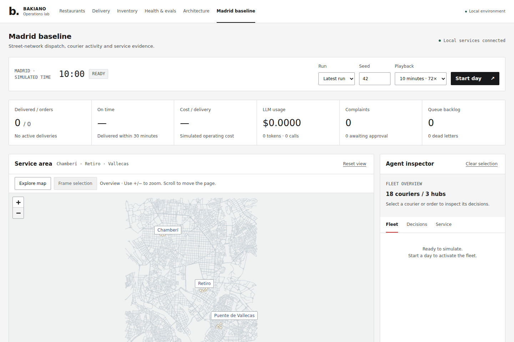 | 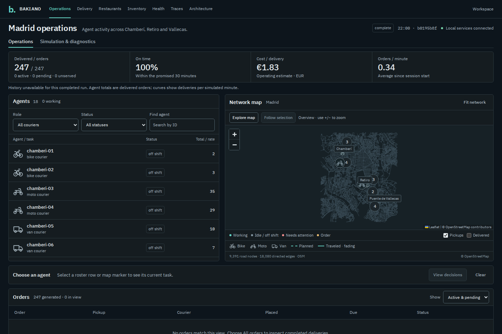 |
| Delivery | 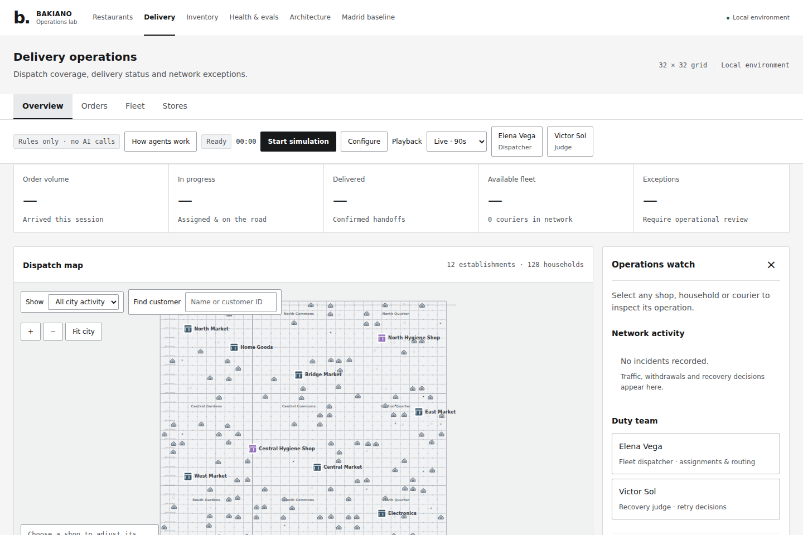 | 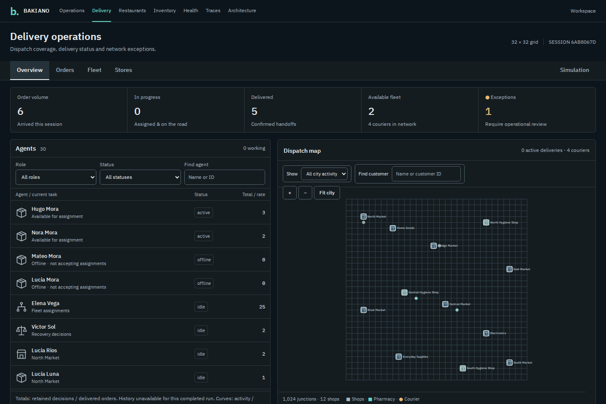 |
| Restaurants | 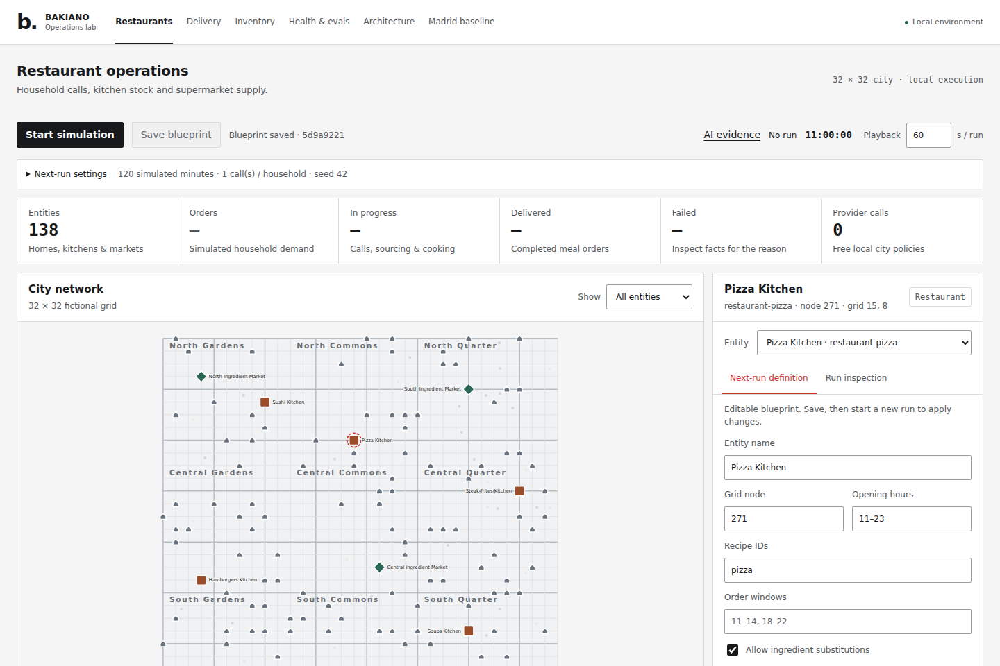 | 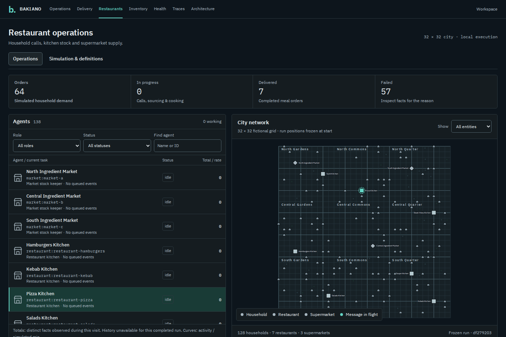 |
| Inventory | 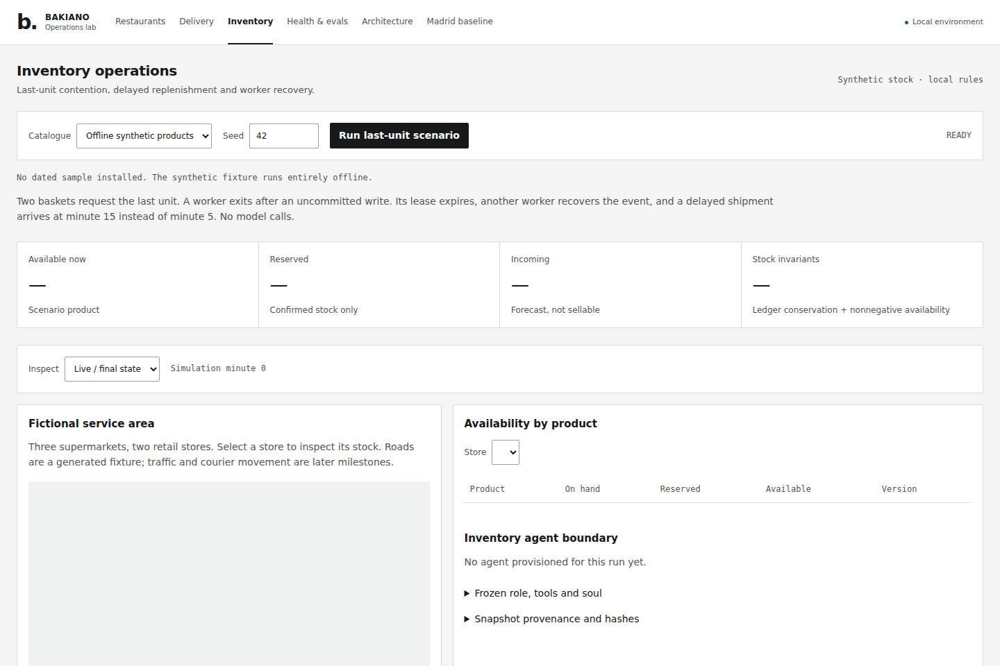 | 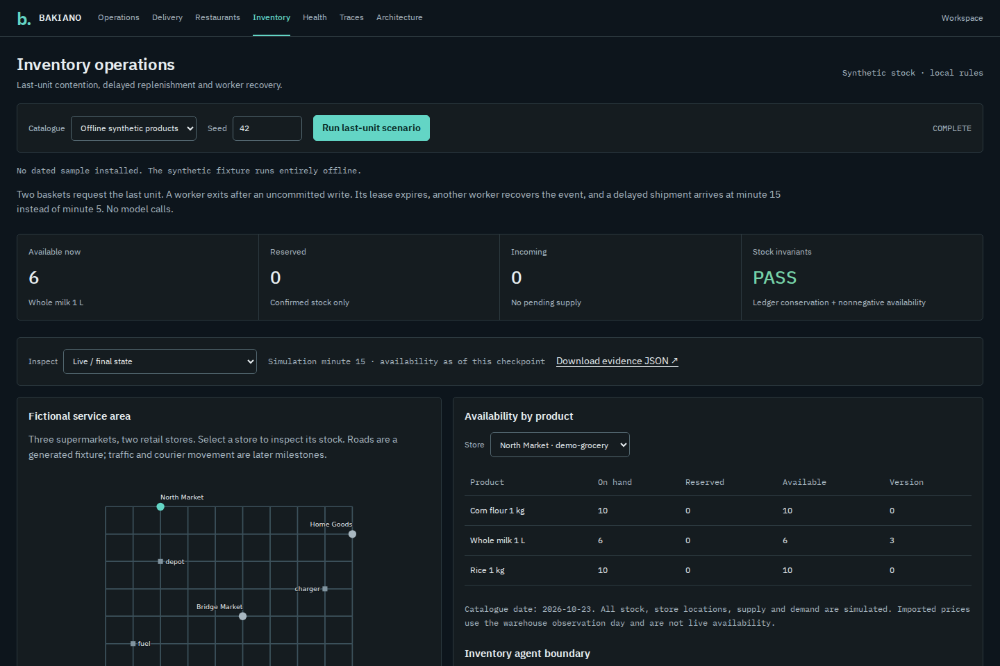 |
| Health | 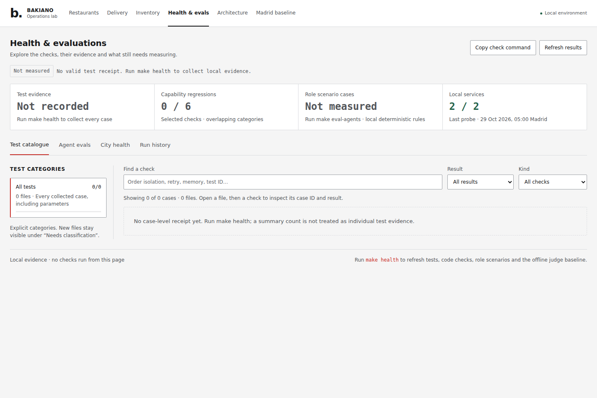 | 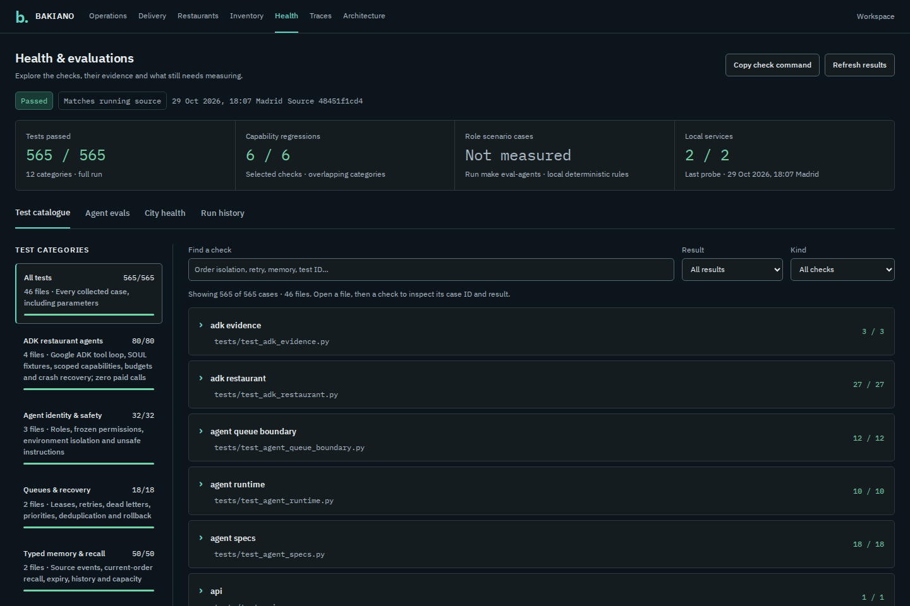 |
| Traces | 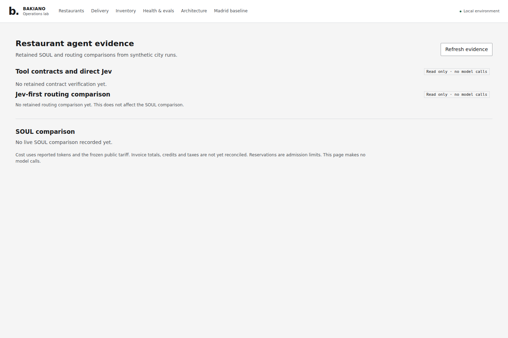 | 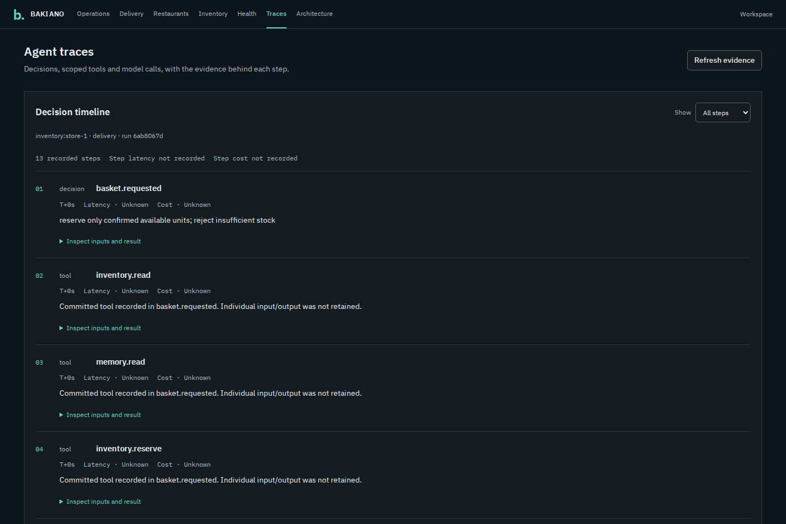 |
| Architecture | 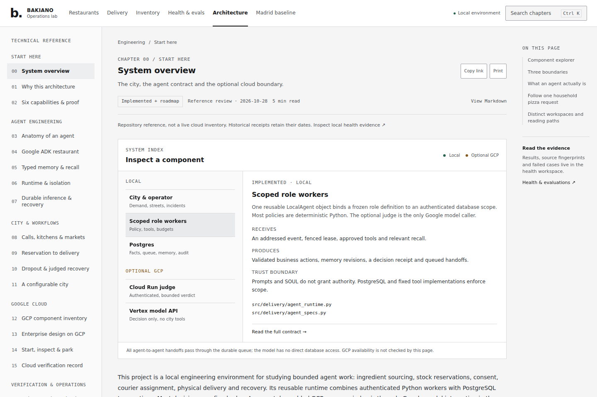 | 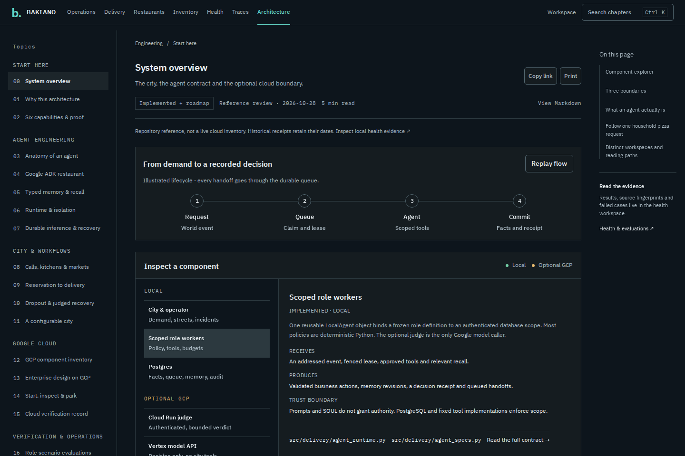 |

## Live demo and reproduction

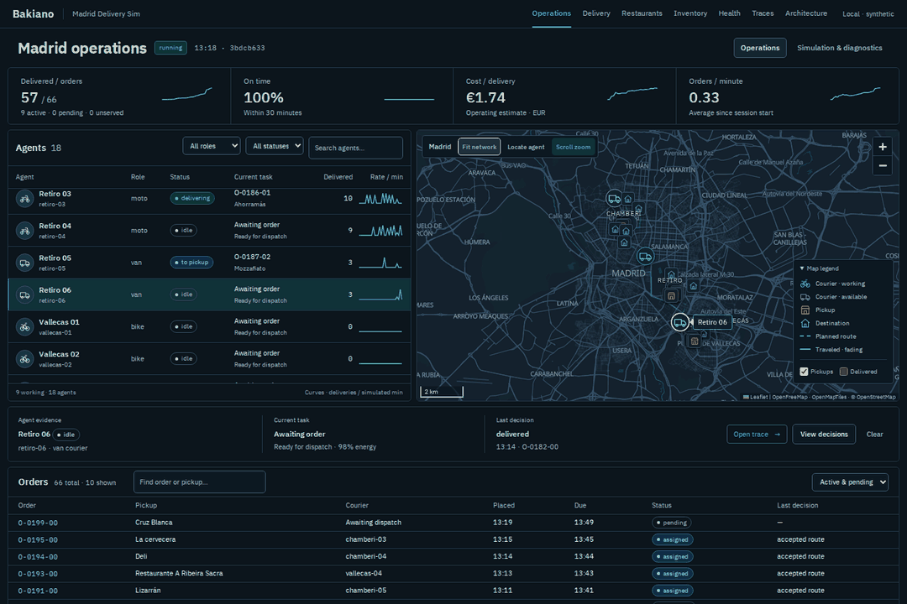

The GIF records a real free local run with agent selection, changing metrics and moving markers.
It plays twice; the [capture metadata](media/ui-demo.json) records provenance and duration.
The application itself honors reduced motion.

From the isolated worktree, in Bash:

```bash
docker compose -p mds-ui -f compose.yaml -f compose.ui.yaml up -d --build
npm ci
npx playwright install --with-deps chromium
node scripts/screenshot_ui.ts --url http://127.0.0.1:8021 --phase after --check
node scripts/record_ui_demo.ts --url http://127.0.0.1:8021
python3 scripts/render_ui_gif.py
```

Node 20 or newer is required for the development scripts. GIF encoding needs Pillow.
To capture specific existing runs, pass `--runs path/to/runs.json`; see the screenshot script's documented flags.
Runtime pages use no frontend framework or chart dependency.

Shared implementation guidance: [design system](DESIGN-SYSTEM.md), [normative tokens and components](../DESIGN.md), [diagram maintenance](diagrams/README.md).
